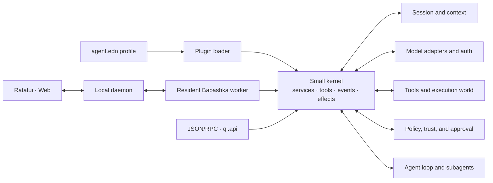

<p align="center">
  
</p>

<h1 align="center">qì agent</h1>

<p align="center">
  <strong>A plugin-first coding agent runtime built with Clojure/Babashka and Rust.</strong>
</p>

<p align="center">
  English · <a href="README.zh-CN.md">简体中文</a>
</p>

<p align="center">
  <a href="https://github.com/rainmote/qi-agent/actions/workflows/ci.yml"></a>
  <a href="LICENSE"></a>
  
</p>

> 形而上者谓之道，形而下者谓之器。
>
> *“What is above form is called dào; what takes form is called qì—the
> instrument or vessel.” — Xici I, Book of Changes*

The project began as `dao`: a set of ideas about how an agent runtime should
work. **qì** (器) is the concrete vessel that carries those ideas. The accent
marks the pronunciation; the character 器 fixes the meaning: an instrument,
tool, or vessel. The name is also the architecture: a small, stable core
remains deliberately uncommitted, while plugins turn it into something useful.

**器以载道 — the vessel carries the Way.**

The default profiles include MCP, web tools, background jobs, reviewed plans and workflows, team tasks/mailboxes, automation and bounded plugin packages. The Web workspace adds files and attachments; editors can connect through ACP v1. See the [capability and verification record](docs/harness-parity-implementation.md) for configuration and limits, and [ACP setup](docs/acp.md) for the editor command.

## Design philosophy

qì agent treats an agent as a composition of capabilities, not as a monolithic
application. The kernel has no model dependency and contains no agent loop.
Models, authentication, sessions, tools, policies, context management,
subagents, and the default loop are all plugins assembled through an EDN
profile.

Four principles shape the project:

1. **Plugins are the architecture.** Features are registered as services,
   tools, observers, interceptors, or UI extensions instead of being wired into
   a central loop.
2. **Composition is data.** An `agent.edn` profile describes what the runtime
   is, which makes variants reviewable, reproducible, and easy to replace.
3. **Effects are reversible.** Every registration creates an effect that is
   withdrawn in reverse order when a plugin stops, preventing stale tools,
   handlers, and policy hooks.
4. **Boundaries are explicit.** Sessions are append-only, tool inputs are
   schema-validated, and filesystem or process access goes through a replaceable
   execution world plus independent trust and approval checks.

The result is a runtime that can be reduced to a deterministic offline test
agent, expanded into a full local coding assistant, or embedded behind another
interface without replacing its core.

### What this enables

| Area | What qì agent provides |
| --- | --- |
| Plugin runtime | Reversible effects, service and tool registries, ordered waterfalls, and EDN profiles |
| Model adapters | OpenAI Responses, OpenAI-compatible APIs such as DeepSeek, and an experimental ChatGPT subscription adapter |
| Local runtime | Resident workers, durable sessions, detach and reattach, forks, checkpoints, compaction, and recovery |
| Coding tools | Read, write, edit, shell, search, anchored hash edits, persistent Clojure REPLs, and optional LSP queries |
| Computer use | Opt-in LCU desktop control, native app consent, screenshot-aware models and turn cleanup; [setup](docs/lcu.md) (Cua Driver also supported) |
| Agent workflows | Streaming, cancellation, steering, follow-ups, background subagents, model switching, and skills |
| Interfaces | Native Rust/Ratatui TUI, local Web UI, JSON event stream, stdin/stdout RPC, and a Clojure embedding API |
| Safety | User-owned trust store, per-action approval, path-aware policy, execution-world isolation, and fail-closed process tools |

### Architecture



The Rust daemon owns task routing and worker lifecycle. Each resident
Babashka worker owns one agent runtime, its plugin graph, session, and REPL.
The terminal and Web clients share the same protocol and append-only source of
truth, so closing a client detaches from work instead of terminating it.

## Installation

### Requirements

| Dependency | Minimum | Required for |
| --- | ---: | --- |
| [Git](https://git-scm.com/) | 2.30 | Managed installation and updates |
| [Babashka](https://babashka.org/) | 1.13 | Runtime, profiles, and installer |
| [Rust](https://www.rust-lang.org/tools/install) | 1.88 | Native daemon and terminal UI |
| [Node.js](https://nodejs.org/) | 22.12 | Web UI and Web test suite only |

Linux and macOS are exercised in CI. Process sandboxing is currently strongest
on macOS; read the [security model](#security-model) before enabling shell tools
on another platform.

### Install from source

```bash
git clone https://github.com/rainmote/qi-agent.git
cd qi-agent
bb install
```

The installer creates a managed Git checkout under `~/.qi-agent/app`, builds the
release TUI in that checkout, and creates `~/.local/bin/qi-agent`. User-owned
data is deliberately kept outside the checkout: the active profile is
`~/.qi-agent/agent.edn`, supervisor state and Web settings stay under
`~/.qi-agent/state` and `~/.qi-agent/web`, and project conversations stay under
each workspace's `.qi-agent/sessions/`. If the launcher directory is not already
on your `PATH`:

```bash
export PATH="$HOME/.local/bin:$PATH"
```

You can now start qì agent from any repository:

```bash
cd /path/to/your/project
qi-agent
```

The launcher preserves the current working directory, so file operations and
`.qi-agent/` project state are scoped to the repository from which it was
started. Trust decisions are stored in the user-owned trust store against that
repository's canonical path.

Future application updates no longer copy source files over the installation:

```bash
qi-agent upgrade --check
qi-agent upgrade
```

The updater fetches the tracked Git branch, builds and validates a separate
checkout, then swaps it into place with rollback on a reported activation
failure. Normal updates do not overwrite existing user or project data; a
missing external profile is created from the repository default. A dirty
installed checkout is rejected instead of being reset or
silently stashed. The first run of this installer migrates the legacy in-app
`agent.edn` to `~/.qi-agent/agent.edn`; later updates preserve it. Use
`qi-agent upgrade --reset-config` only when you intentionally want to replace
that user profile with the repository default. (`qi-agent update` remains the
daemon repair command.)

Custom locations are supported:

```bash
bb install --install-dir /absolute/app/path --bin-dir /absolute/bin/path \
  --repository https://github.com/rainmote/qi-agent.git --branch main
```

The corresponding environment variables are `QI_AGENT_HOME`,
`QI_AGENT_INSTALL_DIR`, `QI_AGENT_BIN_DIR`, `QI_AGENT_REPOSITORY`, and
`QI_AGENT_UPDATE_BRANCH`.

## Quick start

### 1. Verify the runtime without an API key

From the source checkout, run the deterministic two-turn example:

```bash
bb qi-agent --config examples/mock.edn --once "What is six times seven?"
```

### 2. Configure a model

For the public OpenAI Responses API:

```bash
export OPENAI_API_KEY="..."
bb qi-agent --provider openai --once "Read README.md and summarize the project."
```

For DeepSeek:

```bash
export DEEPSEEK_API_KEY="..."
bb qi-agent --provider deepseek --once "Read README.md and summarize the project."
```

The TUI exposes the same providers through `/model`. Provider definitions,
model names, endpoints, retry policies, and tool composition live in
`agent.edn`.

| Provider ID | Authentication | Notes |
| --- | --- | --- |
| `openai` | `OPENAI_API_KEY` | Official Responses API adapter |
| `deepseek` | `DEEPSEEK_API_KEY` | OpenAI-compatible chat completions adapter |
| `chatgpt` | Local Codex login | Experimental; run `codex login` when the cached login has expired |

The ChatGPT adapter reads only the access token and account ID from the local
Codex authentication cache. It uses an internal subscription protocol and is
not the recommended unattended production provider.

### 3. Trust a project deliberately

New projects are untrusted by default. Read-only tools remain available, while
write, shell, and REPL capabilities stay disabled until the project is trusted.
Inside the TUI, inspect the canonical path before allowing it:

```text
/trust
/trust allow
```

Trust and approval are separate controls. Trust makes project resources and
mutating capabilities eligible; approval policy still decides whether a
specific action may run.

## Web UI

The local Web UI provides workspace selection, resumable sessions, streaming
timelines, model settings, remote approval, subagent status, and plugin
inspection.

```bash
npm ci
bb web
```

The server starts at `127.0.0.1:3080` and tries the next port if it is occupied.
Open the authenticated URL printed in the terminal. The host rejects non-loopback
binding by default.

See [Web UI architecture and security](docs/webui.md) for the protocol,
workspace allowlist, and development commands.

## Profiles, project context, and skills

An EDN profile is the complete runtime composition:

```clojure
{:plugins
 [{:ns qi.plugins.session :config {:path nil}}
  {:ns qi.plugins.openai-responses
   :config {:model "gpt-5.6-sol"
            :api-key-env "OPENAI_API_KEY"}}
  {:ns qi.plugins.tools}
  {:ns qi.plugins.runtime :config {:max-steps 12}}]}
```

qì agent discovers trusted project instructions and reusable skills from
standard locations:

```text
~/.qi-agent/AGENTS.md
~/.qi-agent/skills/<name>/SKILL.md
~/.agents/skills/<name>/SKILL.md
<project>/AGENTS.md
<project>/.qi-agent/AGENTS.md
<project>/.qi-agent/skills/<name>/SKILL.md
```

Skill metadata is loaded first; full instructions are read only when selected.
`SYSTEM.md` and `APPEND_SYSTEM.md` provide explicit prompt replacement and
extension layers. Project-owned resources are ignored until the project is
trusted.

## Writing a plugin

A plugin is an ordinary Clojure namespace that exposes a `plugin` map:

```clojure
(ns example.weather
  (:require [qi.kernel :as kernel]))

(def plugin
  {:id :tools/weather
   :description "Example weather tool."
   :start
   (fn [ctx _config]
     (kernel/register-tool!
      ctx
      {:name "weather"
       :description "Return the temperature for a city."
       :parameters {:type "object"
                    :required ["city"]
                    :properties {"city" {:type "string"}}
                    :additionalProperties false}
       :execute (fn [{:keys [city]} _execution]
                  {:city city :temperature-c 25})})
     nil)})
```

Place the namespace on the Babashka classpath and add it to a profile:

```clojure
{:plugins
 [{:ns example.weather
   :config {}}]}
```

Registrations made through the kernel are tracked as effects and removed in
reverse order when the plugin stops. The same mechanism covers services, tools,
event observers, waterfall interceptors, commands, and UI extensions.

Start with [`plugins/example/math.clj`](plugins/example/math.clj) and the
[plugin architecture notes](docs/research.md).

## Sessions and programmatic interfaces

Session logs are append-only JSONL trees. Forking and compaction append new
entries or checkpoints instead of rewriting history:

```bash
bb qi-agent --session .qi-agent/sessions/demo.jsonl --once "Remember 42."
bb qi-agent --session .qi-agent/sessions/demo.jsonl \
  --fork .qi-agent/sessions/experiment.jsonl
bb qi-agent --session .qi-agent/sessions/demo.jsonl --compact
```

External tools can consume a versioned JSON event stream or use stdin/stdout
RPC:

```bash
bb qi-agent --mode json --once "Describe this repository."
bb qi-agent --mode rpc
```

For in-process Clojure integration, `qi.api` is the stable embedding entry
point. The public session service supports submit, steer, follow-up, abort,
state inspection, and subscriptions.

## Security model

> qì agent targets a trusted, single-user local workstation. It is not a
> multi-tenant sandbox, and plugins run with the agent process's authority.

The default runtime applies several independent controls:

- The execution world mediates filesystem, process, and REPL operations and can
  be replaced with a container, SSH host, or test implementation.
- The user-owned trust store authorizes canonical project roots; a repository
  cannot mark itself trusted through its own profile.
- Approval rules evaluate the tool, resolved target, working directory, and
  command before execution.
- On macOS, shell and REPL subprocesses use Seatbelt in `:auto` mode to block
  network access and restrict host filesystem access.
- On systems without a supported safe process provider, `:auto` fails closed:
  conversation and workspace-scoped file tools remain available, but shell and
  REPL tools are not registered.
- The Web host binds to loopback by default, and runtime state is stored with
  owner-only permissions.

Do not load unaudited third-party plugins into a privileged profile. See the
[production readiness guide](docs/production-readiness.md) for deployment
boundaries, backups, resource limits, release verification, and recovery.

## Development

Install the Web dependencies, then run the complete repository test suite:

```bash
npm ci
npm test
```

Useful focused commands:

```bash
bb test                 # Clojure runtime and contract tests
bb tui-test             # Rust tests and real-terminal smoke test
npm run typecheck       # TypeScript checks
npm run test:web        # Web host integration tests
npm run test:web-ui     # React UI tests
```

Browser regressions use mocked API responses and do not access real sessions
or credentials. The project pins Playwright and CI runs the production build in
its matching Chromium: `npm ci`, `npx playwright install chromium`,
`npm run web:build`, then `npm run test:web-browser:ci`. The last command starts
and cleans up a local production preview automatically. For an existing preview,
use `npm run test:web-browser` (`QI_AGENT_WEB_TEST_URL` selects its URL).
`QI_AGENT_BROWSER_CHANNEL` and `QI_AGENT_PLAYWRIGHT_MODULE` remain optional local
overrides; CI uses the locked project dependency and its managed browser.

CI runs on Linux and macOS, checks Rust formatting and Clippy, exercises the
Clojure, Rust, Web host, and React suites, and performs npm and RustSec
dependency audits. A separate build checks all Rust targets with the locked
dependencies on Rust 1.88, the minimum version declared in `Cargo.toml`.
Tagged releases are built for Linux and macOS on x86_64 and
arm64 with checksums and GitHub artifact attestations.

### Repository map

```text
src/qi/kernel.clj          Small kernel, registries, waterfalls, and effects
src/qi/plugin.clj          EDN profile and plugin loader
src/qi/plugins/            Built-in runtime capabilities
apps/tui-rs/               Rust daemon, client, and Ratatui interface
apps/web/                  React Web UI
apps/web-host/             Local authenticated Web host
plugins/example/           Out-of-tree plugin examples
presets/                   Reusable agent compositions
examples/                  Deterministic and provider-specific profiles
test/                      Clojure contract and integration tests
docs/                      Architecture and operational documentation
```

## Documentation

| Document | Topic |
| --- | --- |
| [Ratatui TUI](docs/tui-ratatui.md) | Installation, controls, rendering, and terminal behavior |
| [Web UI](docs/webui.md) | Host architecture, protocol, and security boundaries |
| [Daemon architecture](docs/daemon-agent-architecture.md) | Resident runtime, workers, recovery, and REPL backends |
| [Plugin research](docs/research.md) | Design influences and the reversible-effect model |
| [OMP foundation](docs/omp-plugin.md) | Anchored edits, roles, prompt assembly, and skills |
| [Subagents](docs/subagent-plugin.md) | Delegation, isolation, lifecycle, and structured output |
| [LSP integration](docs/lsp-plugin.md) | Language-server registry and read-only code intelligence |
| [Computer use with LCU](docs/lcu.md) | Desktop control, app consent, screenshots and real desktop E2E |
| [Cua Driver](docs/computer-use.md) | Alternative MCP provider and uncertain-action recovery |
| [Production readiness](docs/production-readiness.md) | Support boundary, backups, limits, and release checks |
| [Hermes install/update research](docs/hermes-install-update-research.md) | Git-managed updates and code/data separation |
| [Naming and migration](docs/qi-agent-migration.md) | `dao` to `qi-agent` compatibility rules |

## Project status

qì agent is in active `0.1.x` development. Its versioned JSON protocol and
append-only session format are tested compatibility boundaries; profile shape,
plugin APIs, and UI details may still evolve before a stable release. The
current production target is a trusted single-user local coding agent—not a
public or multi-tenant service.

## Contributing

Issues, design discussions, documentation fixes, and focused pull requests are
welcome. Before a large change, open a
[GitHub issue](https://github.com/rainmote/qi-agent/issues) describing the use
case and the plugin boundary it affects. New behavior should include tests and
should preserve the project's reversible, capability-oriented design.

## License

qì agent is available under the [MIT License](LICENSE).
