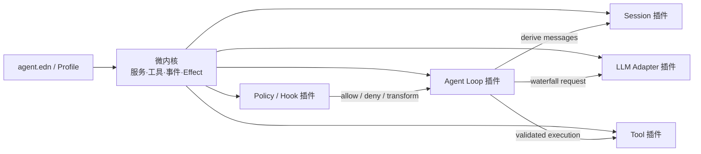

<p align="center">
  
</p>

<p align="center">
  <a href="README.md">English</a> · 简体中文
</p>

# qì agent（器）：Clojure 插件化 Coding Agent

这是一个用 Clojure/Babashka 实现的可扩展 coding agent。它吸收了 Pi 的小核心思路，以及 DeepSeek Harness 的 “Everything is a Plugin” 和可逆 effect 机制。

核心本身不依赖任何模型，也不包含 agent loop。模型与认证 registry、append-only session tree、资源目录、完整 coding 工具、策略、遥测、上下文管理和默认循环都是插件，可通过 EDN 重组。

> **器以载道。** 核心保持小而空，能力由插件装入；它不是一种固定用途的工具，而是一个可以持续重组的 Agent 容器。

默认 profile 已接入 MCP、联网工具、后台作业、审阅计划与工作流、团队任务/邮箱、调度/目标和受限插件包；Web 提供文件与附件入口，编辑器可经 ACP v1 接入。功能范围、配置入口、验证记录及尚未验证的外部兼容性见 [Harness 功能验收记录](docs/harness-parity-implementation.md)，编辑器启动方式见 [ACP 接入](docs/acp.md)。

## 名字：器以载道

项目最初叫 `dao`，强调方法与原则；现在改名为 **器（qì agent）**，强调把这些原则变成一个
可运行、可组合、可扩展的载体。名字来自两组相互呼应的古典表达：

> 埏埴以为器，当其无，有器之用。——《道德经》第十一章

器皿真正可用的部分，是其中可以容纳事物的“空”。这与项目的微内核结构一致：核心不绑定
模型、工具或 agent loop，插件装入之后才形成具体能力。

> 形而上者谓之道，形而下者谓之器。——《易传·系辞上》

`dao` 更像项目遵循的方法论，`qi` 则是承载并实现它的工程实体。因此项目以
**“器以载道”** 为题眼：用一个小而稳定的内核，承载可替换的模型、工具、策略、界面与运行时。
“君子不器”所说的不局限于单一用途，也恰好描述了它希望通过插件获得的开放性。

### 命名规范

面向人的品牌名保留声调，面向机器的标识统一使用 ASCII。`qì` 明确读音，也避免把 `qi`
误解为“气”；工程名使用 `qi-agent`，则兼顾终端输入、包管理器、文件系统和搜索可识别性。

| 场景 | 规范写法 | 说明 |
|---|---|---|
| 页面字标 | **qì** | 使用 Unicode `ì`，全小写 |
| 产品全称 | **qì agent** | 用于 README、Web、TUI 和面向用户的文案 |
| 中文品牌 | **器** | 首次出现可写作“器（qì agent）” |
| 项目题眼 | **器以载道** | 描述微内核与插件能力的关系 |
| GitHub 仓库 | `rainmote/qi-agent` | 仓库、发行包及 URL 使用 ASCII |
| CLI | `qi-agent` | `dao` 仅作为迁移期兼容别名 |
| Babashka task | `bb qi-agent` | `bb agent` 继续兼容 |
| 用户数据目录 | `~/.qi-agent/` | 可用 `QI_AGENT_HOME` 覆盖 |
| Git 应用目录 | `~/.qi-agent/app/` | 只保存受 Git 管理的程序代码与构建后的 TUI |
| 用户 Profile | `~/.qi-agent/agent.edn` | 与 Git checkout 分离，升级默认不改写 |
| 项目状态目录 | `.qi-agent/` | 会话默认位于 `.qi-agent/sessions/` |
| 环境变量 | `QI_AGENT_*` | 旧 `DAO_*`、`BB_AGENT_*` 仅作回退 |
| Clojure 命名空间 | `qi.*` | 内置插件位于 `qi.plugins.*` |
| npm 包 | `@rainmote/qi-agent-web` | Web workspace 包名 |
| Rust 包 / 二进制 | `qi-agent-tui` / `qi-agent` | 发布时同时提供 `dao` 兼容二进制 |
| Profile 文件 | `agent.edn` | `agent` 表示文件职责，不属于旧品牌 |

文案中不要写成 `Qi Agent`、`QI Agent` 或不带声调的 `qi agent`；代码、命令、路径、包名和
URL 中不要使用 Unicode `qì`。迁移边界及旧数据读取规则见
[qì agent 命名与迁移约定](docs/qi-agent-migration.md)。

## 架构一览



## 快速运行

要求 Git 2.30、Babashka 1.13、Rust 1.88 或更新版本。最低 Rust 版本与 `Cargo.toml` 的
`rust-version` 保持一致，CI 会在 Linux 和 macOS 上使用 Rust 1.88 与锁定依赖构建全部
Rust targets。默认交互界面使用 Rust/Ratatui；首次运行先构建
release TUI：

```bash
export OPENAI_API_KEY="..."
bb tui-build
```

需要在其他仓库直接使用本 Agent 时，在本仓库执行一次：

```bash
bb install
```

该命令会把官方仓库克隆为 `~/.qi-agent/app` 下受管理的 Git checkout，在其中构建 TUI，
并创建 `~/.local/bin/qi-agent`；同时保留 `~/.local/bin/dao` 兼容入口。程序与数据明确分离：
用户 Profile 位于 `~/.qi-agent/agent.edn`，supervisor/Web 状态位于
`~/.qi-agent/state`、`~/.qi-agent/web`，历史对话仍位于各项目的
`.qi-agent/sessions/`。只要
`~/.local/bin` 已在 `PATH` 中，之后可从任意仓库启动：

```bash
cd /path/to/another-project
qi-agent
```

启动器不会切换工作目录，因此文件工具、信任状态和 `.qi-agent/sessions` 都属于调用
`qi-agent` 时所在的仓库。可用 `QI_AGENT_HOME`、`QI_AGENT_INSTALL_DIR`、
`QI_AGENT_BIN_DIR`、`QI_AGENT_REPOSITORY` 和 `QI_AGENT_UPDATE_BRANCH` 覆盖默认布局与 Git 来源。

后续更新直接执行：

```bash
qi-agent upgrade --check
qi-agent upgrade
```

更新器会 fetch 指定分支，在独立 checkout 中构建并验证后切换应用目录；若切换过程报告失败会
恢复旧目录。普通更新不会覆盖已有用户数据或项目 `.qi-agent/`；若外置 Profile 缺失则会用
仓库默认值创建。若安装 checkout 存在本地源码改动，更新会拒绝执行，而不是 reset 或静默
丢弃。第一次使用新版安装器时，旧 `~/.qi-agent/app/agent.edn` 会迁移到
`~/.qi-agent/agent.edn`；后续升级默认保留它。只有显式传入
`qi-agent upgrade --reset-config` 才恢复仓库默认 Profile。原有 `qi-agent update` 仍表示 daemon
修复，不是程序升级。若目标 `qi-agent` 或兼容别名 `dao` 是其他程序，安装器会拒绝覆盖。
Hermes 的官方实现依据、两者的数据布局对照和当前未实现边界见
[Hermes Agent 安装与更新调研](docs/hermes-install-update-research.md)。

先运行完全离线的两轮工具调用示例：

```bash
bb qi-agent --config examples/mock.edn --once "六乘七是多少？"
```

运行测试：

```bash
bb tui-test
bb test
```

完整仓库测试入口为 `npm test`。真实浏览器回归使用模拟接口，不读取真实会话或凭据。
项目已固定 Playwright 版本；CI 会构建 Web 生产产物并使用配套 Chromium 验证。
本机依次运行 `npm ci`、`npx playwright install chromium`、`npm run web:build` 和
`npm run test:web-browser:ci`，最后一项会自动启动并清理生产预览。
已有预览可直接运行 `npm run test:web-browser`，使用 `QI_AGENT_WEB_TEST_URL` 指定地址。
`QI_AGENT_BROWSER_CHANNEL`、`QI_AGENT_PLAYWRIGHT_MODULE` 仅作为本机可选覆盖项，CI 不依赖它们。

启动 DeepSeek Harness 风格的本地 WebUI（尚未安装 Node 依赖时先运行 `npm install`）：

```bash
npm install
bb web
```

WebUI 默认从 `127.0.0.1:3080` 开始监听；若端口已占用，会持续尝试 `3081`、`3082` 等后续
端口。启动后打开终端打印的鉴权 URL。它提供工作区白名单、
会话恢复、流式时间线、通用工具卡、远程审批、模型选择、subagent 状态和插件清单；每个打开
的会话由独立 Babashka Worker 执行，TUI 与 WebUI 共享同一份插件和 append-only session。
架构、协议、安全边界与开发命令见 [WebUI 文档](docs/webui.md)。

默认使用官方 OpenAI Responses API：

```bash
bb qi-agent --once "读取 README.md 并总结这个项目"
```

默认提供 `read/write/edit/bash/grep/find/ls`；与 Pi 一致，`read` 的 `offset` 是从 1 开始的
行号，`limit` 是最大行数，另外受 `max-read-chars` 安全上限约束。未读完时结果会明确给出
已读范围、总行数和下一次应使用的 `offset`。其中写入、编辑、shell 和 `bb_repl` 必须先
通过用户 trust store 与 approval；只读工具不要求把项目标为可信。

默认 profile 还加载 OMP-inspired coding foundation 插件：`hash_read` 为完整文件生成
内容哈希快照和逐行锚点，`hash_edit` 用这些锚点批量修改并拒绝过期、错位或互相重叠的
编辑。它不会替换原来的 `edit`；非复杂小改仍可继续使用精确字符串替换。插件同时提供
`/role`，可把 `default/plan/slow/smol/advisor` 角色映射到不同 provider，配置和安全边界见
[OMP 插件文档](docs/omp-plugin.md)。

默认 profile 也启用了 DeepSeek Harness 风格的 subagent 插件族：`delegate_task` 创建完全
独立的子会话，`fork_agent` 只继承已经闭合的父会话轮次；两者支持 persona、只读工具收窄、
结构化输出以及前台/后台运行。后台任务通过 `list_agents`、`wait_agent`、
`interrupt_agent` 管理。同一批 sibling 委派可并行，但结果仍按原 tool-call 顺序回写。
子代理默认不能写文件或执行 shell，完整架构、配置和当前范围见
[Subagent 插件文档](docs/subagent-plugin.md)。

默认 profile 还声明了可选的 LSP server registry，并提供只读 `lsp_query`。它按源文件寻找
最近项目根、首次查询时才启动服务器，并在每次查询前同步当前文件；支持 diagnostics、
definition、references、hover、symbols、implementation 与 type definition。没有安装的
server 只在 `/lsp status` 显示 unavailable，不影响启动，也不会自动下载。配置、协议行为和
安全范围见 [LSP 插件文档](docs/lsp-plugin.md)。

Computer use 通过可选 Cua Driver MCP provider 接入：动态发现桌面工具，沿用信任与审批链，
将截图传给支持图像的模型并在 WebUI 展示。默认关闭；启用示例、驱动要求及操作结果不确定时的
恢复方法见 [Computer use 文档](docs/computer-use.md) 和 `examples/computer-use.edn`。

切换到 DeepSeek：

```bash
export DEEPSEEK_API_KEY="..."
bb web
# 在 Web 顶栏的模型选择器中选择 deepseek-v4-flash

# 或单次从命令行使用独立 profile
bb qi-agent --config examples/deepseek.edn --once "读取 README.md 并总结这个项目"
```

默认 profile 已注册 `deepseek-v4-flash`，通过官方 `https://api.deepseek.com/chat/completions`
接口调用；主 Agent 与子 Agent 均可选择 `deepseek` provider。当前使用非思考模式，以保持工具
调用后的多轮消息回放稳定。

默认 `agent.edn` 使用 `qi.plugins.openai-responses`，从 `OPENAI_API_KEY` 动态取 key，
只向 `https://api.openai.com/v1/responses` 发送凭据。请求默认 `store=false`，支持 SSE、图片、
并行 function call、完整 Responses output item 回放，以及对 408/409/429/5xx 的有界退避。

默认 profile 同时注册独立的 `chatgpt` 订阅 provider；它不会复用 `openai` provider 的
API Key。`qi.plugins.chatgpt` 与 `examples/chatgpt.edn` 会在每次请求前读取
`$CODEX_HOME/auth.json`（未设置时为 `~/.codex/auth.json`），只取 access token 与
account id，不缓存或记录 refresh token。登录失效后运行 `codex login`，无需修改
agent 配置。Web 的“设置 → 模型”会自动显示这份本地登录的缺失、有效、过期、格式错误或
权限不安全状态，但绝不会把 token 返回浏览器。为防止凭据外发，adapter 只接受
ChatGPT/Codex 官方订阅后端。

此方式复用的是 Codex 的 ChatGPT 订阅登录与内部传输协议，不是按量计费的 OpenAI
API key。认证缓存位置是官方文档支持的，但订阅后端协议并不是稳定的公开 API，因而
这个 adapter 标记为 experimental，不作为生产默认值；若上游协议变化，改动被隔离在该插件内。

订阅 adapter 默认使用 HTTP/1.1，并为 ChatGPT 单独维护连接客户端。TLS 握手、连接建立、
连接重置等传输错误会丢弃旧连接状态，以 400ms 起步的指数退避重试 4 次；业务错误和
取消不会重试。可通过 `:http-version`、`:connect-timeout-ms`、`:transport-retries` 与
`:retry-delay-ms` 调整。若 VPN/TUN 的透明路由无法完成 TLS 握手，可为 ChatGPT 插件配置
`:proxy {:host "127.0.0.1" :port 7897}`，显式使用本机 HTTP/mixed proxy。连接层重试
耗尽后不会再由 runtime 成倍重放同一个请求。

`qi-agent` 会连接常驻 supervisor，选择已有 agent 或创建新的持久 session；关闭终端只会 detach，
不会停止后台 run、子 agent 或 REPL。`bb qi-agent` 是 headless/embedding 入口，
`bb agent` 作为兼容 task 保留。
默认模型、端点、工具和插件顺序都在 `agent.edn` 中配置。OpenAI-compatible
插件也可以连接其他兼容 `/chat/completions` 的服务。OpenAI Responses 和 DeepSeek Chat
Completions 都会把文本 delta 立即写到终端，不再等待完整响应下载结束。

每个 agent 的 REPL 默认使用 Babashka，也可以在创建 agent 时切换到原生 JVM Clojure：

```bash
java --version
clojure -Sdescribe
clojure -P
qi-agent --repl-backend jvm-clojure
```

JVM 模式要求系统已有 JDK 和官方 Clojure CLI；macOS 的 Clojure CLI 安装方式见
[官方安装指南](https://clojure.org/guides/install_clojure)。首次使用含 Maven 或 git
依赖的项目时，应先在 sandbox 外运行 `clojure -P` 下载依赖，因为 REPL sandbox 默认禁止网络。
该 backend 会复制当前项目的 `deps.edn` 到 agent 专属可写目录，绝对化项目路径，再以
`clojure -Srepro -M -m qi.repl-worker` 启动；`.cpcache` 不会写进项目根目录。

`--repl-backend` 只影响新建 agent。Babashka 与 JVM Clojure agent 可以由同一个 daemon
同时监督，`qi-agent agents` 的 `repl_backend` 字段可确认选择。模型侧工具名暂时仍叫
`bb_repl`，这是为了保持会话和 policy 兼容；在 JVM agent 中它实际执行原生 JVM Clojure。
也可以在自定义 profile 中把 `qi.plugins.bb-repl` 替换为
`qi.plugins.jvm-clojure-repl`，并配置 `:project-deps`、`:aliases` 和 `:jvm-opts`。

唯一终端入口是 Rust/Ratatui 实现的 `qi-agent` 客户端。Rust daemon 持有任务接纳、路由、worker
监督与恢复；resident Babashka worker 持有 session、agent loop、工具与审批。当前界面按
Qwen Code 的默认暗色、
欢迎 banner、消息符号、双横线输入区与弹窗布局呈现，并包含带代码/diff 分栏预览、可即时切换的 Qwen
内置主题、session 恢复、流式
Markdown/reasoning、紧凑工具状态、多行 Unicode 输入、命令补全、输入历史和原生终端历史滚动，
以及 model、session、theme 和审批选择器。离线体验：

闲置 worker 默认在最后持久活动达到 90 分钟后释放运行资源，但 session JSONL 与 artifact 会保留，
再次 attach 时自动恢复。`QI_AGENT_IDLE_EVICTION_MINUTES` 可设为正分钟数，或设为 `off` 关闭；有客户端、
运行任务或 active/claimed/paused schedule 的 session 不会被回收。`qi-agent status`/`qi-agent doctor` 会显示
回收阈值与扫描状态，`qi-agent update` 可立即触发一次安全扫描。inactive、archived 与 deleted 是不同状态。

Supervisor SQLite 使用显式 schema revision；升级前会在 owner-only 的 `backups/` 下创建一致性
快照并保留最近 5 份，遇到更新版本的 schema 会拒绝启动。`qi-agent backup` 可随时创建手工快照，
`qi-agent doctor` 会运行 SQLite quick check。worker 日志默认单文件 10 MiB、3 份轮转、总数 100，
可用 `QI_AGENT_LOG_MAX_BYTES`、`QI_AGENT_LOG_BACKUPS`、`QI_AGENT_MAX_WORKER_LOGS` 调整。完整上线检查、恢复和
发布校验见 [生产运行手册](docs/production-readiness.md)。

```bash
bb tui-build
apps/tui-rs/target/release/qi-agent --repository-root . --config examples/tui-mock.edn
```

Ratatui 直接打开 controlling TTY，并通过 owner-only Unix socket 使用 daemon JSONL 协议。默认 TUI
采用与 Qwen Code 同类的应用内虚拟历史：alternate screen 中只排版可见消息及少量 overscan，按消息 ID
和消息内行号稳定锚定，完成项高度会缓存；向上阅读时新输出不抢位置，回到底部后恢复自动跟随。鼠标
滚轮、逐行、翻页与首尾快捷键均由应用处理，右侧显示虚拟滚动条。退出会恢复鼠标、屏幕、raw mode
和光标；`--native-scrollback` 可切回原有 inline/terminal scrollback 模式。旧版 TypeScript/React/Ink
前端已经删除，终端 UI 只维护 Rust/Ratatui 实现。

同一次模型响应里的 read/search/list 工具会聚合成一条 Qwen 风格语义摘要，例如
`Searching ToolGroup, reading README.md, listing apps/tui-rs…`；运行中的状态图标和底部短语会动态
变化，完成后整句自动切换为过去时。命令、编辑等动作型工具仍逐条保留，`Ctrl+O` 可展开完整细节。

`Enter` 在空闲时提交、运行中 steer；`Ctrl+Q` 在运行中排入 follow-up；`Alt+Enter`、
`Ctrl+N`、`Ctrl+Enter` 或 `Shift+Enter` 插入换行；`Esc`/`Ctrl+C` 中止当前运行，
`Ctrl+O` 展开或折叠 reasoning 与工具详情，`Tab` 补全 slash command；鼠标滚轮、`Shift+↑/↓`、
`PageUp/PageDown`、`Ctrl+Home/End` 浏览虚拟历史。`/model`、
`/sessions` 和 `/theme` 打开对应选择器。完整安装、按键、命令与当前 TTY/JSONL 过渡架构见
[Ratatui TUI 文档](docs/tui-ratatui.md)。后台 daemon、worker 与 per-agent REPL 的目标架构及
实施阶段见 [Daemon-backed Agent 架构](docs/daemon-agent-architecture.md)。

默认 profile 会显示实际发生的工具调用：

```text
→ tool bb_repl {"code":"(+ 20 22)"}
? approval bb_repl allow
← tool bb_repl ok
value:
42
42
```

审批与工具过程是 trace，写到 stderr；模型文本流写到 stdout，完成后不会再重复打印最终回答。可在 profile
中把 `qi.plugins.trace` 的 `:enabled` 改为 `false` 关闭。字面量
`bb qi-agent --once ""` 是空 prompt，会在调用模型之前被拒绝，所以不会产生任何工具过程。

```bash
bb qi-agent --list
bb qi-agent --help
```

## 运行中控制

交互模式不再被一次生成同步锁死。模型或工具运行时可以继续输入：`Enter` 会 steer
当前运行，`Ctrl+Q` 会排成 follow-up，也可以用 slash command 显式控制：

```text
/steer 先不要改文件，先解释根因
/follow-up 完成后再运行完整测试
/abort
/state
```

公开的 `:agent/session` service 提供 `submit!/steer!/follow-up!/abort!/state/subscribe!`；
`qi.api` 是稳定的嵌入入口。abort 会关闭 SSE、取消退避与进程，并把
`agent/aborted` 写入 session，不会持久化半条 final assistant message。

同一 assistant message 的只读工具默认并行；preflight/approval 保持模型顺序，结果始终
按原 tool-call 顺序写回。只要批中含 `write/edit/bash` 或声明为 sequential 的工具，整批
就顺序执行。

## 会话恢复、树、分叉与自动压缩

`--session` 指定 JSONL 日志；文件存在时自动恢复，不存在时创建：

```bash
bb qi-agent --session .qi-agent/sessions/demo.jsonl --once "记住数字 42"
bb qi-agent --session .qi-agent/sessions/demo.jsonl
bb qi-agent --session .qi-agent/sessions/demo.jsonl --session-info
```

分叉会创建新 session id，并拒绝覆盖已有目标；压缩会保留最近消息，并追加一个
`session/compaction` checkpoint，不重写旧日志：

```bash
bb qi-agent --session .qi-agent/sessions/demo.jsonl \
  --fork .qi-agent/sessions/experiment.jsonl
bb qi-agent --session .qi-agent/sessions/demo.jsonl --compact
```

每个 entry 记录 parent，store 提供活动叶、name/label、`/tree` 与 `/checkout ENTRY_ID`；
session catalog 会索引 `.qi-agent/sessions/*.jsonl`，迁移期也会读取旧的
`.bb-agent/sessions/*.jsonl`。交互模式还提供 `/session`、
`/fork PATH`、`/compact` 和 `/clear`。`/clear` 也只追加
checkpoint，不再截断历史。恢复时无效 JSON 行会被跳过并出现在 `:diagnostics`，因此
进程在写入中途退出留下的半行不会毁掉整段会话。

context manager 根据 context window 与 reserve token 自动触发语义摘要，并以 append-only
checkpoint 保存；摘要失败会退回有界确定性摘要。provider 报 context overflow 时会压缩后
只重试一次；临时 provider error 的退避也可取消。手工 `:compact!` 仍可注入外部摘要。

## 执行安全

coding 工具经过四层独立能力：

- `qi.plugins.execution-world` 统一 `read!/write!/edit!/list!/search!/spawn!`，工具不直接
  访问主机；本地、容器、SSH 或测试 provider 可以整体替换。
- `qi.plugins.trust` 从用户控制的 `~/.qi-agent/trust.edn` 读取 canonical root，按最近
  父目录继承；项目自己的 `agent.edn` 不能自证可信或提前加载外置 namespace。
- `qi.plugins.approval` 可按工具、最终解析路径、cwd、命令 regex 和 provider 决策，
  支持当前 session 临时放行；审批前显示解析后的目标。
- 本地 `bash` 与 `bb_repl` 默认 `:sandbox :auto`。macOS 使用 Seatbelt 禁网并阻止读取
  工作区外用户文件；其他系统找不到安全 provider 时，agent 仍可启动并保留对话与受
  工作区约束的文件工具，但不会注册 `bash/bb_repl`。只有明确接受无隔离执行时才配置
  `:sandbox :none`。

trust store 示例（路径应使用 canonical absolute path）：

```clojure
{:roots {"/absolute/path/to/projects" :allow
         "/absolute/path/to/projects/untrusted" :deny}}
```

新项目默认不可信，Bash、写入和 `bb_repl` 会保持禁用。当前 Rust TUI 不会在启动时自动
弹出项目信任向导；用 `/trust` 查看状态，确认路径无误后用 `/trust allow` 信任，或用
`/trust deny` 明确保持受限。决定会原子写入上述用户 trust store，并立即刷新项目资源。
非交互的 `--once`、JSON/RPC 模式同样不会自行弹出确认。需要逐次确认工具时，把
`agent.edn` 中 approval `:mode` 改成 `:ask`。

## 资源、模型与外部协议

resource catalog 会发现用户级 `~/.qi-agent/`、跨 agent 的 `~/.agents/skills/`，以及项目级 `.qi-agent/` 的
`AGENTS.md`、`SYSTEM.md`、prompt 和 skill。skill 启动时只注入 name/description；模型用
`read skill://<name>` 读取完整 `SKILL.md`，并可继续读取
`skill://<name>/references/...` 等同目录资源。`load_skill` 保留为兼容入口，用户也可通过
`/skill:<name> [args]` 显式调用。YAML frontmatter、同名优先级、include/ignore、隐藏 skill
及子 Agent 继承均由 catalog 统一处理；`/reload` 先完整验证新目录再原子切换。

model registry 允许多个 adapter 同时注册 metadata，并用 `/model`、`/model PROVIDER` 或
`--provider PROVIDER` 查看和切换。auth store 每次请求动态解析 Codex cache 或环境 key，
不缓存 refresh token。

外部 UI 和 IDE 可以使用版本化 JSONL：

```bash
bb qi-agent --config examples/mock.edn --mode json --once "六乘七是多少？"
bb qi-agent --config examples/mock.edn --mode rpc
```

RPC 保留 prompt、steer、follow-up、abort、state、clear、compact、sessions、providers、
select-provider、reload 与 shutdown，并新增声明式、JSON Schema 校验的 Remote API，覆盖
session snapshot/cursor、turn、interaction、model、command、runtime 与 subagent。stdout 只
输出 version 1 JSON，诊断仍走 stderr。用户消息也支持 typed text/image content blocks，
ChatGPT Responses 与 OpenAI-compatible adapter 会转换成各自的多模态格式。

## 插件写法

插件是一个暴露 `plugin` map 的普通 Clojure namespace：

```clojure
(ns my.weather
  (:require [qi.kernel :as kernel]))

(def plugin
  {:id :tools/weather
   :description "Weather tool"
   :start
   (fn [ctx config]
     (kernel/register-tool!
      ctx
      {:name "weather"
       :description "Get weather by city"
       :parameters {:type "object"
                    :required ["city"]
                    :properties {"city" {:type "string"}}
                    :additionalProperties false}
       :execute (fn [{:keys [city]} execution]
                  {:city city :temperature 25})})
     nil)})
```

把 namespace 所在目录加入 `bb.edn :paths`，再在 profile 中挂载：

```clojure
{:plugins [{:ns my.weather :config {:token-env "WEATHER_TOKEN"}}]}
```

注册 service、tool、observer、interceptor 和自定义 disposer 都会形成 effect。插件卸载时，effect 按注册的逆序撤销，不会留下旧工具或事件监听器。

TUI 是 daemon 的可替换客户端，不再是由 Babashka 启动的插件。worker 通过 frontend-neutral
Remote API 和 `qi.ui` prompt 边界暴露能力，不把 Rust UI 状态塞进 agent loop。当前界面处理
approval、select、confirm、input 和 custom prompt，也会投影 JSON-safe status、widget 和
notification，并通过 Remote API 调用注册在 host 的 shortcut handler。Clojure
message/entry/tool renderer 函数不能跨进程变成 Ratatui widget，函数值字段只显示不可用占位符；
需要原生 renderer 时仍可使用 `qi.plugins.tui`。
工具仍可分别声明 `:render-model` 和 `:render-tui`，避免模型上下文文本与终端表现互相绑死；
TUI 扩展示例见 `plugins/example/ui_demo.clj`。

## 设计要点

- 会话日志是模型上下文的来源；用户、assistant 和 tool message 都先写入 append-only event log，再推导下一轮 messages。
- 工具输入在执行前做 JSON Schema 校验，覆盖 composition、nullable、格式与常见
  字符串/数值/数组约束；未知字段可通过 `additionalProperties false` 拒绝。
- 工具返回 canonical JSON value，渲染成模型文本是另一层职责，避免让下游解析随意 prose。
- `:tool/pre-execute`、`:tool/execute`、`:tool/post-execute` 和 `:llm/request` 是有序 waterfall；策略无需修改 agent loop。
- `bb_repl` 工具和执行后端分离：`qi.plugins.clojure-repl` 只依赖
  `:execution/repl` service。默认 provider 是持久化 Babashka 子进程，也可选择隔离的
  原生 JVM Clojure 进程；二者共用单行 EDN 协议、interrupt/reset/status、持久定义与
  replay-safe cell 恢复语义。REPL 中的 `def` 可跨调用复用；超时后只重启该 agent 的
  REPL，不终止 resident worker。
- `qi.cancellation` 的 token 会传到 adapter；取消会关闭 SSE transport 并记录
  `agent/aborted`。运行时同时提供 `:agent/cancel` service，供 TUI、HTTP server 或
  上层调度器调用。
- `:llm/stream` 是 provider-neutral live event；console renderer 只依赖
  `:text/delta`、`:response/completed` 和 `:response/error`，不依赖供应商 SSE 格式。
- macOS sandbox 隔离 `bash` 与 `bb_repl` 子进程。同进程插件仍继承 agent 权限；生产环境
  应审计插件来源，并在其他操作系统接入容器或远程 provider。

架构来源与插件化实践见 [调研报告](docs/research.md)；当前与 Pi 的逐项能力差距、优先级和
落地验收标准见 [Pi 差距分析](docs/pi-gap-analysis.md)；后台连续执行的目标进程模型、协议、
恢复语义和迁移计划见 [Daemon-backed Agent 架构](docs/daemon-agent-architecture.md)。

## 目录

```text
src/qi/kernel.clj            微内核、注册表、waterfall、effect
src/qi/plugin.clj            EDN profile 与 namespace 加载器
src/qi/cancellation.clj      协作式取消 token 与资源关闭回调
src/qi/streaming.clj         provider-neutral SSE framing
src/qi/plugins/runtime.clj   默认 agent loop 插件
src/qi/plugins/execution_world.clj 统一文件与进程执行世界
src/qi/plugins/context_manager.clj token 预算、语义压缩与恢复重试
src/qi/plugins/model_registry.clj 多 provider/model 目录与选择器
src/qi/plugins/subagent.clj provider-neutral subagent registry 与生命周期
src/qi/plugins/subagent_in_process.clj 隔离的 spawn/fork provider
src/qi/plugins/subagent_tools.clj 委派与后台任务控制工具
src/qi/plugins/stdio_session.clj 长驻、可取消的 argv/stdio 进程 provider
src/qi/plugins/lsp.clj       LSP registry、JSON-RPC 与文档同步 runtime
src/qi/plugins/lsp_tools.clj 只读 lsp_query 与 /lsp 命令
src/qi/plugins/resources.clj 可信 context/prompt/skill 发现与 reload
src/qi/plugins/bb_repl.clj   持久化 Babashka 子进程 provider
src/qi/plugins/clojure_repl.clj 模型侧 bb_repl 工具
src/qi/repl_worker.clj       REPL 子进程的 EDN worker
src/qi/plugins/openai.clj    DeepSeek/OpenAI-compatible adapter
src/qi/plugins/openai_responses.clj 官方 OpenAI Responses adapter
src/qi/plugins/chatgpt.clj   ChatGPT subscription/Codex auth adapter
src/qi/plugins/session.clj   可恢复、可 fork/compact 的 append-only session
src/qi/plugins/session_title.clj 首轮完成后自动生成确定性会话标题
src/qi/protocol.clj          version 1 JSON event 与 stdin/stdout RPC
src/qi/api.clj               稳定的公开 Clojure embedding API
src/qi/command.clj           line/TUI 共用的 slash command dispatcher
src/qi/ui.clj                可逆 UI extension 与 prompt API
apps/tui-rs/                    qi-agent daemon/client、Ratatui UI、worker proxy 与故障测试
src/qi/plugins/tui.clj       兼容的 JLine/Clojure 全屏 TUI
src/qi/plugins/*.clj         tools、trust、approval、policy、stream、trace、mock
plugins/example/math.clj        仓库外置插件示例
examples/mock.edn               无 API key 的确定性演示
examples/chatgpt.edn            复用 Codex 登录态的 ChatGPT 订阅 profile
examples/deepseek.edn            DeepSeek API profile
test/agent/test_runner.clj      契约与端到端测试
```
