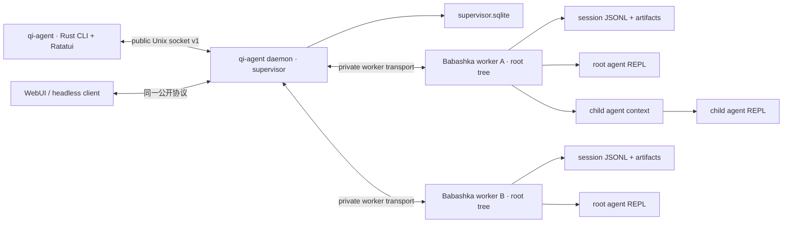
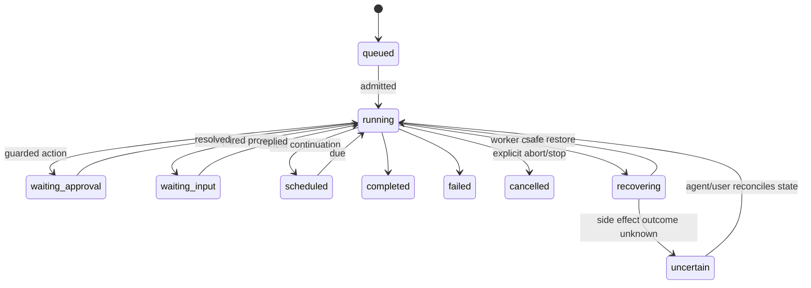

# Daemon-backed Agent 与 Per-Agent Clojure REPL 架构

状态：Implemented  
首次整理：2026-08-23  
最后更新：2026-08-28

实施结果：阶段 0–6 已落地。Rust `qi-agent` 是唯一 TUI 与 supervisor 入口；WebUI 和 headless client
使用同一 public socket；resident worker、per-agent REPL、retained child、durable messaging、
goal/schedule、恢复、诊断与用户级 OS service 均已实现。结果不确定的外部副作用不会自动重放。

## 1. 决策摘要

qì agent 已从“Babashka host 启动一个 Rust TUI 子进程”迁移为常驻的本地 agent runtime：

> Rust TUI 只拥有连接；daemon 拥有任务接纳、路由和生命周期；Clojure worker 拥有实际执行；每个 agent 拥有独立 REPL。

由此得到四条不可破坏的约束：

1. TUI 退出、PTY 消失或客户端崩溃只产生 `detach`，不得隐式 `abort`。
2. daemon 不执行模型、工具、shell 或 REPL 代码；它只监督和路由 worker。
3. 每个 root session tree 由一个 resident worker 持有，root 和每个 child agent 都有独立 REPL。
4. transcript、task 和显式 durable state 是事实源；任意 REPL 内存对象不是持久事实源。

这个边界参考 Prime Agent 的
[总体架构](https://github.com/PrimeIntellect-ai/prime-agent/blob/main/packages/coding-agent/docs/architecture.md)、
[daemon 架构](https://github.com/PrimeIntellect-ai/prime-agent/blob/main/packages/coding-agent/docs/daemon.md)、
[客户端连接架构](https://github.com/PrimeIntellect-ai/prime-agent/blob/main/packages/coding-agent/docs/agent-connection.md)
与 [RLM runtime](https://github.com/PrimeIntellect-ai/prime-agent/blob/main/packages/coding-agent/docs/rlm-runtime.md)，
但执行内核继续采用本项目的 Babashka/Clojure 插件系统，而不是复制 TypeScript + IPython 实现。

## 2. 目标与非目标

### 2.1 目标

- 关闭或杀死 TUI 后，后台模型请求、工具、子 agent、调度任务和 REPL 继续运行。
- 重新打开 TUI 可以 attach 到已有 agent，并通过 snapshot + event cursor 恢复一致视图。
- 每个 agent 有独立、持久、可中断、可重启的 Clojure REPL 命名空间。
- daemon、worker、REPL 和 session 具有明确故障域，单个 agent 崩溃不影响其他 root tree。
- 所有修改命令可去重；不确定的外部副作用不会被自动重放。
- TUI、headless CLI 和 WebUI 使用同一公开协议，不建立第二套执行路径。

### 2.2 非目标

- 初版不提供跨主机 hosted control plane。
- OS 进程隔离不是安全沙箱；现有 trust、approval、execution world 和 Seatbelt 边界仍然必须保留。
- 不承诺 worker 或 REPL 崩溃后恢复任意函数、future、流、socket 或 Java 对象。
- 不在第一阶段把所有 child agent 拆成独立 OS worker。
- 不追求外部副作用的 exactly-once；系统提供幂等接纳、可见的 uncertain 状态和安全恢复。

## 3. 术语

| 概念 | 含义 | 稳定性 |
| --- | --- | --- |
| `workspace_id` | canonical workspace root 的稳定标识 | 持久 |
| `session_id` | append-only 对话与事件树的身份 | 持久 |
| `agent_id` | 可寻址的运行实体；root 和 child 都有 | 持久 |
| `task_id` | daemon 接纳的一次持久工作记录 | 持久 |
| `goal_id` | 可跨多个 run 有界推进的持久目标 | 持久 |
| `run_id` | 一次 prompt、continuation 或 scheduled tick | 单次运行 |
| `worker_id` | 一个 root session tree 的执行进程 | 进程级 |
| `generation` | worker 每次重启递增的世代 | 进程级 |
| `attachment_id` | 一个 TUI、CLI 或 Web 客户端连接 | 临时 |
| `client_id` | 客户端重连时保留的稳定身份 | 客户端级 |
| `command_id` | mutation 的幂等键 | 命令级 |

必须区分 session、agent、task、goal 和 run：一个 agent 绑定一个主要 session；goal 可以包含多次 run，task
记录每次被接纳的工作。TUI attachment 只是观察和控制这个 agent 的临时入口。

## 4. 进程拓扑



### 4.1 Rust 客户端

Rust 可执行文件是唯一终端入口，命令名统一为 `qi-agent`：

```text
qi-agent                              打开 agent 列表或 attach/create 后进入 TUI
qi-agent agents                       列出 active、idle、failed、saved agents
qi-agent attach <agent-id-or-name>    连接已有 agent
qi-agent run --detach "..."           创建后台任务并立即返回
qi-agent repl <agent-id>              打开或代理该 agent 的 REPL
qi-agent status                       查看 daemon 和 worker 状态
qi-agent doctor                       检查 socket、描述文件、租约和孤儿进程
qi-agent doctor --fix                 只清理可证明已过期的 lease
qi-agent backup                       创建一致的 supervisor SQLite 快照
qi-agent update                       收养 live worker、恢复缺失 worker、刷新 lease
qi-agent service print|install|uninstall
                                 管理 launchd/systemd 用户服务
qi-agent stop <agent-id>              显式停止一个 agent tree
qi-agent shutdown                     显式停止所有 worker 和 daemon
```

客户端负责：

- 终端渲染、键盘、剪贴板、主题和本地 UI 偏好；
- 建立连接、能力协商、attach、cursor 保存和重连；
- 将 snapshot/event 投影成界面；
- 作为 controller 时提交 prompt、steer、follow-up 和审批。

客户端不得直接持有 `AgentSession`、provider、工具、session writer、REPL 进程或 worker 管理句柄。

### 4.2 daemon supervisor

daemon 负责：

- 公共 socket、客户端认证和 attachment；
- agent 发现、create/attach/stop、名称和路由；
- task admission、全局配额、workspace/session lease；
- worker 启动、健康检查、重启、收养和 generation；
- mutation command journal 与幂等结果；
- goal continuation、schedule claim/dispatch、跨 root agent 消息和全局诊断；
- snapshot/event 的有限缓存和 attachment-local backpressure。

daemon 不得执行：

- 模型 provider 调用；
- 工具、bash、文件修改和 compaction；
- REPL eval；
- session transcript 全量扫描；
- root 内部的 parent/child agent loop。

当前使用一个 Rust 安装产物、三个运行角色：普通 `qi-agent` 是客户端，`qi-agent daemon serve` 是无 TTY
supervisor，`qi-agent worker serve` 是每个 root tree 的常驻代理。客户端发现 daemon 不存在时触发拉起；daemon
通过 owner-only launch lease 排除重复实例，并用 `setsid` 进入独立 session，之后不再受客户端生命周期控制。

### 4.3 resident worker

一个 worker 持有一个 root session tree：

- root `AgentSession` 和队列；
- provider、工具、policy、approval 和 execution world；
- context manager 和本 tree 的实际模型/工具执行；
- root 与 retained child registry；
- root 以及每个 child 的 REPL backend；
- transcript append、artifact 写入和运行期事件。

现有 `qi.plugins.subagent-in-process` 可以继续作为第一版 child provider。child 仍是独立 plugin context，
但随 root worker 一起恢复。将来可以新增 `:external-worker` provider，而不改变模型侧 spawn/message API。

### 4.4 catalog/indexer

session catalog 的目录扫描不应阻塞 daemon 或 active worker。初版可以在线程池执行；当 session 数量增大后，
再拆成只读 catalog subprocess。catalog 失败只能让 list/search 请求失败，不能终止 active task。

## 5. 所有权和生命周期规则

| 动作 | 影响 |
| --- | --- |
| TUI 正常退出 | detach；agent、run、REPL 不变 |
| TUI 被 `SIGKILL` | socket EOF；效果等同 detach |
| `Esc` / 单次 `Ctrl+C` | 显式 `run.abort`，不停止 agent |
| `qi-agent stop <agent>` | 停止 root worker、child 和各自 REPL |
| `qi-agent shutdown` | 协调停止全部 worker 和 daemon |
| daemon 崩溃 | worker 继续执行并重连新 daemon |
| worker 崩溃 | 只影响一个 root tree；进入 recovering |
| REPL 崩溃或超时 | 只重启该 agent REPL；agent loop 保持存活 |

历史 bridge 在 TUI 退出和 RPC EOF 时调用 `abort!`；该 bridge 已删除。当前 transport closure 只关闭
attachment；终止执行必须通过 `turn.abort`/`run.abort` 或 `agent.stop` 等具名 mutation 命令。

### 5.1 Session 生命周期与闲置回收

session 现在沿三条互不替代的轴公开状态：

| 轴 | 值 | 含义 |
| --- | --- | --- |
| `lifecycle` | `draft / live / archived` | 持久会话是否已完成过一轮，或是否被显式停止 |
| `activity` | `working / idle` | 当前 agent loop 是否仍在执行 |
| `residency` | `resident / inactive / stopped` | worker/child runtime 是否还驻留内存 |

正常闲置回收只把 `resident` 变为 `inactive`。它不会归档或删除 session JSONL、artifact、durable state
与 retained-child roster。后续 attach、agent message、schedule tick 或其他需要 runtime 的命令会从原 session
惰性恢复；`session_id` 保持不变，worker `generation` 递增。显式 `qi-agent stop`/`qi-agent shutdown` 才把 lifecycle
推进到 `archived`。

默认阈值为 90 分钟，可通过 daemon 环境变量配置：

```text
QI_AGENT_IDLE_EVICTION_MINUTES=90     # 任意正有限分钟数
QI_AGENT_IDLE_EVICTION_MINUTES=off    # 关闭（none 也兼容）
```

扫描间隔为 `max(1 分钟, min(5 分钟, threshold / 3))`。`qi-agent update` 也会立即执行一次扫描，结果在
`idle_sweep` 中返回；`qi-agent status` 与 `qi-agent doctor` 暴露阈值、上次/下次扫描时间。

整棵 root tree 只有在以下条件全部成立时才会 graceful shutdown：root 与所有 resident child 都为 idle、
最后持久事件达到阈值、没有 attachment、没有 running task、没有 active/claimed/paused schedule、worker
连接健康且活动时间有效。候选在 worker lifecycle fence 内再次刷新并完整判定，避免与新 turn/attach 竞态。
时间无效时 fail closed，不回收并报告 `invalid-activity-time`。

当 root tree 因 attachment、活动任务或近期 root 活动而不能整体回收时，最多按最老优先 passivate 两个
符合相同条件的 resident child。passive child 保留 roster 和 JSONL；attach、消息或子 agent RPC 会 hydrate。
普通 schedule 会钉住对应 session；当前没有冷调度后到点拉起的机制。

## 6. Task 和 Run 状态机



规则：

- 一个 agent 默认只有一个 active run；新输入通过 submit、steer 或 follow-up 进入既有队列语义。
- TUI detach 不触发任何状态迁移。
- 没有 controller 时，允许的工作继续；需要审批的动作持久进入 `waiting_approval`。
- approval 不因最后一个订阅者离开而自动 deny。可配置超时，但必须产生持久、可见的决策事件。
- schedule tick 在投递前先 claim 并推进下次时间；crash 后不重放结果不确定的 tick，错过的周期合并而非积压。
- 失败的 quality gate 只能触发有界 continuation；达到预算或时间上限不等于 task 成功。

## 7. 公开客户端协议

### 7.1 Transport

初版复用项目已有 JSONL 投影，通过 owner-only Unix domain socket 传输。Windows 后续使用 named pipe。
每行一个 envelope，stdout/stderr 不参与该协议。

```json
{
  "version": 1,
  "type": "command",
  "client_id": "client-...",
  "command_id": "cmd-...",
  "agent_id": "agent-...",
  "method": "prompt.submit",
  "params": {"message": "run tests"}
}
```

公开方法至少包括：

```text
daemon.hello              capability negotiation
daemon.status/doctor/backup/update/shutdown
agent.list/create/attach/detach/take_control/stop
prompt.submit/steer/follow_up（映射到 turn.*）
turn.submit/steer/follow-up/abort/state
session.snapshot/clear/fork/compact
interaction.list/resolve
repl.eval/interrupt/reset/status/describe
state.snapshot/get/put/delete
subagent.status/stop/delete
agent.message.send
schedule.list/add/cancel
goal.set/list/status/cancel/complete/resume
```

### 7.2 幂等 mutation

所有修改命令以 `(client_id, command_id)` 为幂等键：

1. daemon 在 dispatch 前写入 command journal。
2. 已完成命令重复提交时返回已存结果。
3. 已接收但没有 durable result 的命令返回 `uncertain`，不得盲目重放。
4. 客户端重连必须复用原 command ID。
5. 客户端确认持久结果后，daemon 才能压缩旧 journal。

读取请求不需要 journal，但应携带 request ID 便于关联响应。

### 7.3 Event cursor 和 snapshot

事件游标必须包含世代：

```json
{"generation": 3, "sequence": 182}
```

- sequence 只在同一 generation 内比较。
- attach 携带最后 cursor；daemon 返回 complete、partial 或 unavailable replay 状态。
- replay 不可用或 generation 改变时，以 worker 生成的 coherent snapshot 为权威。
- snapshot 包含 session、transcript、agent state、queue、pending interactions、models、children、REPL 状态和最新 cursor。
- 大 snapshot 使用 begin/chunk/end 分块，daemon 不构造第二份历史大小对象。
- live token delta 可以不持久；最终 message、tool result 和状态迁移必须持久。

### 7.4 多客户端与 backpressure

- 同一 agent 可以有多个 observer，但默认只有一个 controller。
- controller lease 可显式释放或 `take-control`，危险操作仍受 approval policy 约束。
- 慢 attachment 停止接收增量事件，其他客户端和 worker 不受影响。
- daemon 不维护无界 per-client queue；恢复时从 cursor replay 或发送新 snapshot。

## 8. daemon 与 worker 的私有协议

当前实现不把 daemon 持有的匿名 stdin/stdout pipe 当作 worker 的生命线：

1. daemon 为每个 root tree 生成 `worker_id`、随机 token 和 owner-only descriptor。
2. 独立的 `qi-agent worker serve` 代理拥有 private Unix socket 和 Babashka 子进程；daemon 只连接该 socket。
3. daemon 认证后，worker 代理保证 `worker.register` 是首帧，再发布业务事件，避免注册/事件竞态。
4. daemon 崩溃时代理、Babashka、agent loop 和 REPL 保持存活；事件写入有限 buffer，最终状态继续落盘。
5. replacement daemon 扫描 descriptor，以 token 重新连接并收养 live proxy；机器重启后则递增 generation，
   重建 proxy/Babashka，仅恢复 transcript、durable state 和 replay-safe cell。
6. 同一 session JSONL 的 canonical path 同时受 SQLite 唯一约束和进程文件 lease 保护，只有一个 writer。

descriptor 权限为 `0600`，目录/socket 为 owner-only；它只保存恢复必需字段，不保存完整环境变量或 provider
凭据。worker 意外退出使用有界指数退避，连续失败超过预算后停止自动恢复。

## 9. Per-Agent Clojure REPL

### 9.1 定位

REPL 是 agent 的可编程控制面，类似 Prime Agent 的 model-facing IPython kernel。它适合：

- 精确计算和数据变换；
- 在多个模型轮次之间保存辅助定义；
- 编写任务局部 helper；
- 通过 typed host bridge 创建 child、发送消息、读写 durable state 和 artifact。

REPL 不负责 provider 调用、agent loop、child 生命周期、budget 或 transcript。上述状态仍由 worker 持有。

### 9.2 Backend 接口

`qi.plugins.bb-repl` 和 `qi.plugins.jvm-clojure-repl` 都实现统一的
`:execution/repl` service：

```clojure
{:backend    :babashka | :jvm-clojure
 :status     (fn [] ...)
 :eval!      (fn [request] ...)
 :interrupt! (fn [eval-id] ...)
 :reset!     (fn [options] ...)
 :describe   (fn [] ...)
 :close!     (fn [] ...)}
```

每个 agent context 创建独立 service，使用独立 namespace：

```text
qi.agent.<short-agent-id>
```

进程可以 lazy start，但逻辑 REPL handle 在 agent 创建时就存在。状态机为：

```text
cold → starting → ready → busy → ready
          ↓          ↓
        failed ← restarting
```

默认 backend 是 Babashka。新建 agent 时可通过
`qi-agent --repl-backend jvm-clojure` 选择原生 JVM Clojure；选择值写入 owner-only worker
descriptor 并由 worker proxy 传给 resident worker。新会话还可通过 `qi-agent --preset ID`
选择注册表中的 Agent Preset。公共 `agent.create` 只接受 `preset_id`，不接受客户端提交的
任意 `config_path`；daemon 通过 Clojure Preset 注册表按系统优先、用户其次的受控根目录
解析并完成 structural validation，然后把配置序列化到 owner-only runtime snapshot。Worker
始终从该不可变快照启动，因此创建后修改或删除用户 Preset 不会改变既有 Session 的行为。
解析后的 `preset_id` 和快照 `config_path` 同时写入 worker descriptor，其中 `preset_id` 还
持久化到 SQLite session/agent 记录。拒绝结果在 `error.data.type` 返回稳定类型（如
`unknown_preset`、`broken_preset`、`preset_validation_failed`）。`--config PATH` 仅用于可信的
daemon 启动默认配置；安装版 launcher 会固定提供该参数，而 `--preset` 只决定新 Agent
使用的注册 Preset。

daemon 的 `agent.list` 返回 `preset_id`、`config_path` 和 `repl_backend`，客户端只复用
workspace、Preset/默认 profile 和显式 backend 均匹配的 agent。因此同一 daemon 下不同
Preset 和两种 backend 可以并存；已有 agent 不会因后续命令行选项而切换 Preset 或 backend。

#### 9.2.1 Creator Profile 与模式选择

`preset.list` 是 daemon-scoped、只读的 discovery API，并通过
`preset.discovery.v1` capability 发布。它只返回 `id`、展示名称、描述、排序、信任级别以及可选的
`broken` 布尔值，不返回 Preset 目录、`config_path`、配置正文或解析错误细节。TUI 的
`qi-agent new` 在任何 `agent.create` 发生之前调用该 API 并从 `/dev/tty` 选择模式；
`qi-agent new --preset creator` 用于非交互自动化。该路径始终新建 Agent，不复用匹配的旧 Agent。
WebUI 同样先调用 `/api/presets`，新 Session 第一次提交时才发送 `presetId`；Web Host 明确拒绝
`configPath`/`config_path` 与空值、超长或格式非法的 Preset ID，并只透传安全的
`error.data.type` 机器错误类型。现有 Session 的 open/attach 不接受 UI 模式切换，fork 继承源
Session 的持久化 `presetId`。

内置 `creator` Preset 是 `standard` 的能力超集，增加三组受限工具：

- `runtime_inspect`：返回确定性、只读的 Kernel 插件、工具、命令、hook 和 service 所有权元数据；
  不返回 service value、handler、disposer、配置正文或可执行对象。
- `runtime_plugin`：支持 Host 代码中审核过的内置插件目录（当前开放
  `qi.plugins.math`），也支持 Clojure EDN Blueprint。Blueprint 是宿主编译的纯数据 AST，
  可声明带 JSON Schema 的工具、词法变量、条件/集合变换和有界 Session 状态，但不能解析
  symbol/Var、namespace、Java interop、文件、网络、线程、`eval` 或 `load-string`。除兼容的
  activate/deactivate/status 外，二者共享不可变 Package 的 define/inspect/run/update/stop/undefine，
  保留 current/next 指针、精确源码、包级失败诊断；更新时保留逻辑插件状态，失败不推进 current，
  并尽力恢复上一运行版本。Creator Plugin dispose 时会回收所有动态工具和状态。
- `preset_guide`、`preset_inspect`、`preset_author`：指导并执行用户 Preset 的 roster 检查、源码读取、
  复制、完整 EDN 原子更新、结构校验和删除。系统 Preset 永远只读，变更只在新 Session 的不可变
  snapshot 中生效。`creating-agent-presets` 与 `creating-runtime-blueprints` 两个 progressive skill
  随 Creator Preset 分发，复制 Preset 时会和其他 skill/assets 一起复制。

第一阶段仍故意不支持任意 `load-string`、模型提供的 Clojure 源码、任意 namespace/path 或卸载
Preset 基础插件。EDN Blueprint 用 Clojure 的数据/闭包/Atom/可撤销注册机制获得动态定义、热替换、
状态保留和失败回滚效果，不把主 worker 变成通用代码执行器。系统 Preset 仍只读；用户修改流程必须
先复制为用户 Preset，并在创建新的 Agent/Session 时重新经过 structural validation 与不可变
snapshot。与 DeepSeek Harness 创造模式的逐项差距和后续边界见
[创造模式对齐分析](deepseek-creator-gap-analysis.md)。

也可在 profile 中显式加载：

```clojure
{:ns qi.plugins.jvm-clojure-repl
 :config {:root "."
          :sandbox :auto
          :project-deps true
          :aliases [:dev]
          :jvm-opts ["-Xmx2g"]
          :timeout-ms 10000
          :max-output-chars 20000}}

{:ns qi.plugins.clojure-repl}
```

JVM provider 使用官方 Clojure CLI 和 JDK。它在 agent 专属 sandbox 目录生成 `deps.edn`：
保留项目 deps/aliases，把相对 classpath 与 `:local/root` 转成绝对路径，并加入 qì agent runtime
源码路径。启动命令使用 `-Srepro`，工作目录和 `CLJ_CONFIG`/`CLJ_CACHE`/`GITLIBS` 均指向
agent 专属可写区域，所以不会污染项目根目录。Seatbelt 允许读取 JDK、Clojure CLI、
`~/.m2`、`~/.gitlibs` 和 workspace，但仍禁止网络；依赖必须提前用 `clojure -P` 获取。
外置 `:local/root` 依赖仍受 workspace sandbox 边界限制。

### 9.3 当前协议与可选演进

Babashka 与 JVM Clojure 当前复用同一个单行 EDN REPL worker，并已增加 request ID、interrupt、reset、
status 和 lifecycle event。后续可选增加 nREPL backend；nREPL 的 persistent session、multi-response
和 interrupt 适合人工 IDE attach。外部 nREPL 不能默认暴露到 `0.0.0.0`，应由 daemon 代理或使用不可公开的
loopback/Unix-socket endpoint。

无论使用 EDN worker 还是 nREPL，host request 都必须走独立控制通道，避免正在执行的 cell 因等待同一串行
eval 通道的响应而死锁。

### 9.4 Typed host bridge

REPL bootstrap 注入薄函数，不把 daemon 或 worker 内部对象暴露给 eval：

```clojure
(qi.agent/spawn! {:name "reviewer" :prompt "检查 API"})
(qi.agent/send! {:to "reviewer" :message "重新检查最新 diff"})
(qi.task/status)
(qi.state/get :plan)
(qi.state/put! :plan {:remaining ["tests" "docs"]})
(qi.artifact/write! "notes/result.edn" result)
```

`spawn!` 只返回 admission handle，不等待 child 最终答案。child 通过 durable inbox/report 或 artifact 回传结果。

### 9.5 REPL 恢复承诺

恢复分三级：

| 情况 | 承诺 |
| --- | --- |
| TUI detach | REPL 进程和全部 namespace 原样保留 |
| daemon 重启、worker 存活 | REPL 原样保留，worker 重新注册 |
| worker 或 REPL 崩溃 | 重新 bootstrap，仅恢复显式 durable state 和安全 cell |

artifact 中可保存：

```text
repl/bootstrap.clj
repl/cells.jsonl
state.edn
```

普通 eval 默认不自动重放。只有显式标记 `:replay-safe true` 的纯定义 cell 才可在恢复时重放；具有文件、shell、
网络或外部系统副作用的 cell 永不自动重放。REPL 重启必须追加 `repl/restarted` 可见事件，不能让 agent 误以为
旧 namespace 仍然存在。

## 10. 子 Agent 与消息

当前 one-shot subagent 演进为 retained child：

1. parent 请求 spawn/fork 后立即获得 `agent_id`、`session_id` 和状态 handle。
2. child 拥有独立 plugin context、session、queue、REPL、inbox 和 artifact 目录。
3. child 完成当前 run 后仍可寻址，直到显式 stop/delete。
4. child 使用 `report!` 或 `agent.message.send` 回传 parent；消息写入 durable inbox 后才确认接纳。
5. busy target 的消息按 `steer` 或 `follow_up` 投递；idle target 的消息可以触发新 run。
6. 删除 child 写 tombstone 并解除路由，不立即删除 transcript 和 artifact。
7. parent registry 必须在 kernel/REPL 重启、compaction 和 worker restore 后仍可重建。

root tree 内消息由 worker 直接处理；跨 root tree 消息经 daemon 路由。daemon 不解析消息语义，只验证身份、大小、
速率和目标状态。

## 11. 持久化

当前 supervisor 布局：

```text
$XDG_RUNTIME_DIR/qi-agent/
  daemon.sock
  worker-<worker-id>.sock

$XDG_STATE_HOME/qi-agent/
  supervisor.sqlite
  workers/<worker-id>.json
  logs/daemon.log
  logs/<worker-id>.log

<workspace>/.qi-agent/
  sessions/<session-id>.jsonl
  artifacts/<session-id>/
    agents/<agent-id>/
      state.edn
      repl/
        cells.jsonl
        host-outbox.edn
```

具体 artifact 会随插件能力扩展，但 session transcript 始终是对话事实源；per-agent durable state 与 REPL
cell journal 始终按 `agent_id` 隔离。

### 11.1 supervisor SQLite

当前包含：

```text
agents             agent_id, root_agent_id, session_id, worker_id, name, status
workers            worker_id, pid, generation, status, heartbeat_at
tasks              task_id, agent_id, status, budgets, timestamps
commands           client_id, command_id, status, result, timestamps
schedules          schedule_id, agent_id, next_at, claim, policy
goals/goal_runs     goal_id, request_id, status, continuation budget
leases             resource_type, resource_key, owner, expires_at
messages           message_id, source, target, delivery status
```

SQLite 只保存 supervisor 元数据和索引；完整 transcript 仍使用 append-only JSONL。session writer 已使用单一
`FileOutputStream` append handle，每条记录 flush，并按配置在关键边界 `fsync`；启动时也会修复中断留下的尾部
半行边界。

### 11.2 Session 和 artifact

- session JSONL 是对话、tool result、状态迁移和恢复标记的审计事实源。
- compaction 追加 checkpoint，不重写旧历史。
- worker descriptor 保存 canonical workspace/session/repository/config path、进程身份和 generation。
- 当前恢复从 descriptor 指向的 config 重新装载；固定解析后的 profile snapshot/hash 是后续可增加的可复现性强化。
- credential、refresh token、完整 process env 和 worker auth token 不得进入 workspace artifact。

## 12. 并发与 workspace 安全

多个 agent 同时编辑一个 workspace 会产生比模型并发更严重的问题。daemon 应管理资源 lease：

- 只读 run 可以共享 workspace。
- 默认同一 shared workspace 同时只允许一个 write-capable run。
- 需要并行写入时，为每个 agent 创建独立 git worktree 或替换 execution-world provider。
- shell、REPL 和工具都必须受同一 execution world、trust 和 approval 边界约束，不能让 REPL 绕开工具权限。
- child 请求只能收窄 capability，不能扩大 parent/provider allowlist。
- detached task 等待审批时不持有无必要的 workspace write lease。

进程拆分用于生命周期和故障隔离，不等于安全 sandbox。运行不可信代码仍需容器、受限用户或远程 execution world。

## 13. 可观测性与诊断

daemon 和 worker 应提供结构化状态：

```text
daemon version/socket/schema revision
active attachments/controllers
worker pid/generation/heartbeat/restart count
agent phase/current run/queue length
task budgets and continuation count
REPL state/pid/current eval/restart count
session path/cursor/last durable event
pending interactions and schedules
workspace/session leases
bounded stderr tail
```

`qi-agent doctor` 只做安全诊断，并检查 schema revision 与 SQLite quick check；当前 `--fix` 也只清理可由过期时间证明失效的 lease，不会删除 socket/descriptor 或
杀进程。进程修复不能仅凭 PID 存在与否判断，必须同时验证 descriptor token、进程启动时间和 worker identity。

## 14. 实施计划

### 阶段 0：单一 Rust TUI

本阶段删除旧 TypeScript/React/Ink 实现，只保留 Rust/Ratatui：

- 删除 `apps/tui/`、Ink 构建脚本、测试和依赖；
- `npm run tui:build` 与 `npm run test:tui` 直接运行 Rust；
- daemon 直连稳定后删除历史 namespace `qi.plugins.tui-ink` 和反向子进程 bridge；
- 安装器直接暴露 Rust `qi-agent` 二进制。

验收：Rust unit/UI/PTY、daemon 端到端、Web typecheck 和 Web tests 全部通过。

### 阶段 1：最小 daemon vertical slice

- 为 Rust 程序增加 daemon client、Unix socket 和 capability handshake。
- 增加 `qi-agent daemon serve/status/shutdown`。
- daemon 能 create/list/attach 一个 resident Babashka worker。
- worker 继续使用现有 `--mode rpc`，但 transport EOF 不再 abort session。
- TUI 直接消费 daemon 转发的 ready/response/event。
- 实现 session canonical-path lease。

验收：启动慢任务后 `kill -9` TUI，worker 继续运行；重新 attach 可看到一致 snapshot 和最终结果。

### 阶段 2：可靠 attach、replay 与幂等

- 引入稳定 `client_id + command_id` 和 append-only command journal。
- event cursor 升级为 `{generation, sequence}`。
- 实现 attach snapshot、有限 replay、chunked snapshot 和 attachment-local backpressure。
- 加入 observer/controller lease。
- pending approval 在无客户端时保持等待。

验收：重复提交相同 mutation 不产生第二次工具副作用；慢客户端不阻塞 worker；cursor 缺失时自动 resync。

### 阶段 3：正式 per-agent REPL

- 将现有 bb-repl 扩展为完整 `ReplBackend`。
- root 和每个 child context 都获得独立 logical REPL handle。
- 增加 eval ID、interrupt、reset、status、生命周期事件和 bootstrap。
- 加入 durable state、cell journal 和 `:replay-safe` 语义。
- 增加 daemon `repl.*` API；之后可选 nREPL adapter/IDE attach。
- 增加可与 Babashka 并存的原生 JVM Clojure provider、per-agent backend 选择和隔离的
  Clojure CLI/deps cache 目录。

验收：root 与两个 child 的定义互不泄漏；TUI 重连后定义仍在；杀死某个 REPL 只重启该 REPL，并明确报告状态丢失范围。

### 阶段 4：retained subagent 与 durable messaging

- child session 和 context 在 run 完成后继续存活。
- 增加 inbox、report、send、follow-up 和 tombstone。
- parent registry 与 usage attribution 持久化。
- root tree 内直接路由，跨 tree 经 daemon 路由。

验收：child 完成后仍能接收 follow-up；parent/child 任一方 TUI detach 不影响消息；worker restore 后 roster 一致。

### 阶段 5：worker 收养与 daemon 恢复

- 从 pipe 迁移到 private reconnect transport。
- 保存 owner-only worker descriptor 和 token。
- daemon 重启后收养 live worker；worker 在 daemon 缺席时继续执行和落盘。
- worker crash 使用有界退避恢复；不重放 uncertain side effect。

验收：杀死 daemon 不终止 worker、task 或 REPL；新 daemon 启动后恢复原 `agent_id`、generation-aware snapshot 和控制权。

### 阶段 6：调度、目标、配额和 OS 服务

- durable goal、bounded autonomous continuation、one-shot/cron schedule；
- provider、token、CPU、worker 数量和 workspace write lease 配额；
- macOS launchd、Linux systemd user service；
- 完整 `status/doctor/update/shutdown` 生命周期。
- 显式 SQLite schema revision、事务迁移、迁移前自动快照与 `qi-agent backup` 手工快照；
- worker 日志大小/份数/总数配额，以及 owner-only 状态文件迁移。

具体配置：`QI_AGENT_MAX_WORKERS` 限制 resident worker 数量；`QI_AGENT_ALLOWED_PROVIDERS` 提供 provider
allowlist；`QI_AGENT_MAX_TOKENS_PER_RUN` 拒绝显式超过上限的 `max_tokens/max_output_tokens`；
`QI_AGENT_WORKER_CPU_SECONDS` 使用 OS `RLIMIT_CPU` 限制单个 worker generation；同一 workspace 同时只允许
一个 root tree 持有 write lease。goal continuation 最多 20 次，schedule retry 最多 10 次且指数退避封顶。

验收：机器重启后 future schedule 自动恢复；正在执行而失去 worker 的 goal 进入 `uncertain`，经人工核对后
使用 `goal.resume` 显式恢复，避免重放未知副作用。到点投递不会形成无界 backlog；达到限制进入
`budget_exhausted/failed`，不会被误报为成功。

## 15. 迁移映射

| 现有模块 | 迁移方向 |
| --- | --- |
| `apps/tui-rs` | 成为 `qi-agent` 客户端和唯一 TUI；增加 socket client |
| `qi.plugins.tui-ink` | 已删除；Rust TUI 直接连接 daemon |
| `qi.protocol/rpc!` | 拆成可复用 envelope/handler 与 worker private transport |
| `apps/web-host/worker.ts` | 已改为 public daemon socket client，不再 spawn Babashka |
| `apps/web-host/sessions.ts` | 保留只读 catalog；create/open/attach/RPC 经 daemon 完成 |
| `qi.plugins.session` | 继续作为 transcript 事实源，强化 writer lease 和 durability |
| `qi.plugins.bb-repl` | 默认 Babashka per-agent `ReplBackend`；共享进程协议实现 |
| `qi.plugins.jvm-clojure-repl` | 可选原生 JVM Clojure `ReplBackend` |
| `qi.repl-worker` | 增加异步协议、interrupt、reset、status 或替换为 nREPL adapter |
| `qi.plugins.subagent-in-process` | 从 one-shot child 演进为 retained child provider |
| `qi.plugins.stdio-session` | 继续提供受 execution-world 约束的持久外部进程能力 |

## 16. 必须自动化的故障测试

1. TUI 正常退出和 `SIGKILL` 都只 detach。
2. TUI 重连过程中模型仍在 streaming，snapshot 不重复最终 message。
3. 相同 command ID 重发不会重复 write/bash。
4. worker 在 bash 或文件修改中崩溃，恢复后显示 `uncertain` 且不自动重放。
5. 最后一个客户端离开时 pending approval 保持等待。
6. 两个客户端同时 attach，只有 controller 能 mutation。
7. 两个 worker 争用同一 session path，只有一个获得 lease。
8. 慢客户端断流后，其他客户端和 worker 继续推进。
9. REPL 超时只重启对应 agent REPL，不终止 agent tree。
10. root/child REPL namespace、durable state 和 capability 不互相泄漏。
11. daemon 崩溃后 worker 继续，replacement daemon 可以收养。
12. schedule claim 后崩溃不重放不确定 tick，missed ticks 被合并。

自动化分布在 `apps/tui-rs/tests/daemon_faults.rs`、Rust projection/daemon/worker 单元测试和
`test/agent/test_runner.clj`：覆盖 controller/observer、命令幂等、慢 attachment、审批断连、会话单写者、
worker/daemon/整机恢复、uncertain mutation、root/child REPL、retained roster、durable messaging、
bounded goal 与 schedule claim/restart。Web 另有真实 Web→daemon→worker 端到端测试。

## 17. 完成定义

只有同时满足以下条件，daemon 化才算完成：

- 任意 UI 都是可替换客户端，关闭 UI 不影响执行；
- daemon 可以重启而不终止 live worker；
- worker 崩溃只影响一个 root tree，并有明确恢复或 uncertain 结果；
- 每个 agent 的 REPL 独立、可观察、可中断，且恢复承诺没有夸大；
- command、event、snapshot 和 session lease 可以解释所有重连竞态；
- approval、workspace write 和 child capability 在无人值守时仍保持原安全边界；
- Rust TUI、headless CLI 和 WebUI 共享同一协议和事实源。
