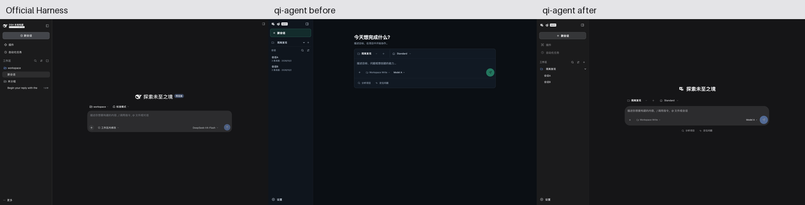
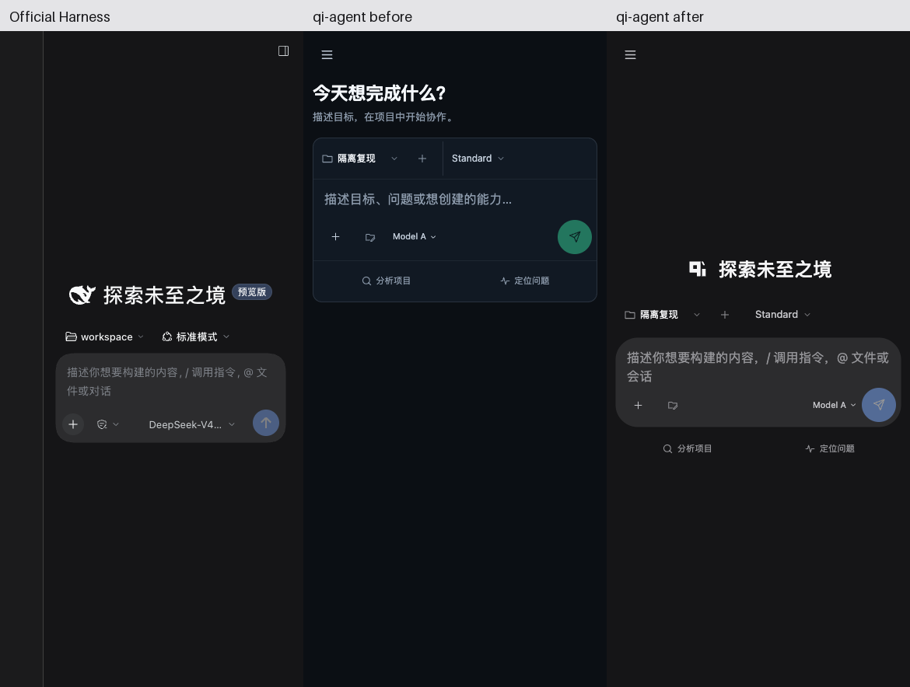

# Web 页面与 DeepSeek Harness 对照

本轮是独立本地候选，未推送、创建 PR、合入或部署。参考日期为 2026-10-19。

- qi-agent 基线：`d3173b5f01b86565bf300d54b7b24ea9d14d6060`，独立分支 `codex/web-deepseek-harness-20261019`。
- 官方参考：[`deepseek-ai/deepseek-harness@687f282e8625c6b8d11ff58211a90524be2e4317`](https://github.com/deepseek-ai/deepseek-harness/tree/687f282e8625c6b8d11ff58211a90524be2e4317)，版本 `0.2.1-rc.2`。
- 参考来源包含官方源码及实际构建后的客户端。使用官方自带隔离 scaffold 和录制会话生成可交互历史；没有调用模型，也没有将官网宣传图当作产品验收截图。
- 官方 MIT 声明与归属保留于 [THIRD_PARTY_NOTICES.md](../THIRD_PARTY_NOTICES.md)。保留 qì 品牌，不暗示 DeepSeek 官方关系。

2026-10-19 后续补齐了浏览器历史验证，并最小修复导航与目录刷新竞态。**此前“完整浏览器回归”应理解为仓库现有 Chrome 生产预览脚本覆盖的场景通过，不代表全部浏览器或交互的穷尽验收。** [补测范围、结果和限制](ui-harness-20261019/history-followup/README.md)；[当前源码指纹](ui-harness-20261019/history-followup/tested-ui-source.json)。初次交付 `4838bb2c1c7810eb83798baba733d7335cebbf2c` 的证据仍保留。

## 实际界面对照

截图均来自 Chrome 的真实渲染，DPR 1。宽度为 CSS 像素。三列拼图只做等比缩放和添加列标题，顺序为官方参考、改造前、改造后。

- [桌面设置：参考与改造后](ui-harness-20261019/comparisons/desktop-settings.png)
- [移动设置：改造前后](ui-harness-20261019/comparisons/mobile-settings.png)
- [参考截图与视口清单](ui-harness-20261019/reference/manifest.json)；[改造前](ui-harness-20261019/before/manifest.json)；[改造后](ui-harness-20261019/after/manifest.json)。
- 真实后端链路截图：[1440px](ui-harness-20261019/e2e/composer-1440.png)、[375px](ui-harness-20261019/e2e/composer-375.png)。

| 对照项 | 官方参考与本轮实现 | 证据与边界 |
| --- | --- | --- |
| 页面骨架 | 使用中性灰、蓝色操作强调、280px 桌面侧栏、两行会话标题与页签、居中对话及输入区；正文宽度随视口变化。 | 1440px 浅色/深色、新会话与历史会话截图。保留 qì 标识、快捷开始及真实运行概览。 |
| 会话列表 | 紧凑单行标题、选中态、工作区归属；插件与自动化入口上移。保留真实会话切换、新建和已有归档操作。 | 浏览器覆盖切换、重复操作、晚到响应、离开再返回。无会话时需要会话的入口禁用。 |
| 输入区 | 圆角输入面板；附件与权限左置，模型与发送右置；使用既有键盘、IME、菜单和命令状态逻辑。 | 320/375/414/768/1440px 几何、菜单边界、失焦关闭、取消与草稿恢复。输入宽度变化会重算高度，窄屏提示完整显示。 |
| 消息与思考 | 保留 Markdown；补回只有 reasoning 的消息，思考摘要按需展开。 | 新增真实失败再修复的 reasoning 回归；历史、实时事件、重连与刷新沿用同一投影。 |
| 工具折叠 | 增加简洁、标准、详细、完整四种展示。成功结束的历史可折叠工作步骤；保留最终答复、审批决定、执行结果。详细模式活动工具平铺，完整模式始终逐项展示。 | 失败、取消、结果不确定或仍有活动的轮次保持过程可见；完成不代表验收通过。工具缺失结果仍标未确认。 |
| 焦点与展开 | 自动折叠保护正在操作的工具；历史工具组头获焦点不切换布局；手动整轮收起重置子项展开。 | 两条浏览器 red/green：活动转完成、已完成组头获焦点；点击与键盘焦点均检查。 |
| 子任务 | 真实任务状态与结果放入可折叠 disclosure；完成明确写成“已完成 · 尚未验收”。 | 浏览器 fixture 校验展开内容；真实模型派发子任务及官方同场景未实测。 |
| 设置 | 对齐宽面板、侧栏分类、三种主题卡片；新增四种工作步骤展示设置。 | 模态 portal、背景 inert、Escape、Tab 焦点循环及关闭后返回；移动标签不被裁切。 |
| 响应式 | 1024px 起完整侧栏，761–1023px 使用侧栏入口与抽屉，760px 以下手机抽屉；设置在窄屏重排。 | 截图宽度 320/375/390/768/1024/1440；回归覆盖平板和手机会话入口、设置及焦点。 |

## 后端和安全边界

本轮没有改动 `apps/web-host`、`api.ts`、daemon、Worker、command_id、审批控制器或权限策略，也没有新增依赖。界面偏好仅影响显示，不发起命令。命令幂等、未知结果对账、停止请求去重、项目可信确认、真实写操作的人为审批均沿用既有链路。

测试在独立临时目录和全新浏览器上下文运行。沙箱拒绝读取 Codex 配置、SSH/AWS、钥匙串、用户 Chrome 数据与 NAS 路径；仅允许本机网络。真实 E2E 使用 Web Host → Rust daemon → Babashka Worker 和离线 provider，检查批准前后真实临时文件变化，外部模型调用数为零。没有访问用户凭据、重启已有服务或放宽宿主安全设置。

## 验证

初次交付的命令、原始输出和指纹保存在 [checks/](ui-harness-20261019/checks/) 与 [tested-ui-source.json](ui-harness-20261019/tested-ui-source.json)，对应 `4838bb2`。当前候选使用[后续 checks](ui-harness-20261019/history-followup/checks/index.json)及[后续指纹](ui-harness-20261019/history-followup/tested-ui-source.json)，六项检查均已重新运行。

| 检查 | 结果 |
| --- | --- |
| `npm run typecheck` | 通过 |
| `npm run web:build` | 通过；保留 Vite 原有大于 500kB 的包体提示，未将其隐藏 |
| `npm run test:web-ui` | 75 通过，0 失败、取消、跳过 |
| `npm run test:web-browser:ci` | 通过；包含重复提交/丢响应/恢复、停止、会话切换、四种展示、子任务、菜单与模态焦点及窄屏布局；补测桌面/移动历史、挂起目录及桌面旧目录覆盖，页面异常为零 |
| `npm run test:web-e2e` | 8 通过，0 失败、取消、跳过；真实 Host/daemon/Worker，离线模型 |
| 官方构建及实际页面采集 | 7 项构建门禁通过（保留原始输出，未单独记录退出码）；采集测试 1 通过，8 张截图、页面异常为零 |
| 改造前/后页面采集 | 基线 17 张，最终候选 19 张；页面异常为零 |
| `npm run test:web` | 候选与冻结基线均为 82 通过、3 失败。控制器准备阶段调用 `/bin/ps` 被 macOS 隔离策略拒绝（EPERM），随后三项候选所有权/验收测试失败。没有降级为跳过或宣称全绿。 |
| 独立只读复核 | 发现并修复平板入口、手机设置裁切、异常轮次折叠、活动工具完成与历史组头焦点问题；后续修复历史目录未返回与旧响应覆盖问题，最终范围内无已知 P1/P2。复核者没有自行重跑浏览器。 |

广义 Host 套件的上述环境阻碍仍存在。本轮不签发维护控制器完整验收 PASS，也不代表容器镜像、发布链或部署验收。

## 明确差异与未验证项

- 保留 qì 品牌、原有图标、快捷开始、运行概览及业务设置；没有复制 DeepSeek 标识。手机使用可关闭抽屉，官方参考在该视口保留窄轨道，未声称逐像素等同。
- 四种展示偏好保存在本机 `localStorage`，不与 Host 跨设备同步；没有实现官方“下次发送时收起”等全部折叠时机选项。
- 未复制官方账户、遥测、字体、快捷键等不属于 qi-agent 当前后端能力的设置项。
- 官方真实模型流式生成、权限弹层、子任务派发与其所有折叠状态没有实际跑通；这些仅核对官方源码，标记为未实测。qi-agent 对应链路的覆盖范围见各测试记录。
- “返回”包含模态/菜单关闭后焦点返回；浏览器历史补测覆盖 1440px/390px 会话后退/前进、新会话视图、重载、离开页面再返回，以及目录挂起时的分叉会话恢复。晚到旧目录覆盖额外在桌面验证；没有穷尽所有导航竞态。历史只恢复工作区/会话选择，不保证跨页面持久恢复草稿或滚动位置。
- 手机实机软键盘/安全区、Electron 与其他浏览器仍未验证。[最新19张候选截图](ui-harness-20261019/history-followup/after/manifest.json)和[历史返回截图](ui-harness-20261019/history-followup/browser-history.json)另存，初次证据未覆盖写入。
- 两张对照截图已在任务内直接显示并保留本地文件；持久附件流程不可用，未声称创建 Library 附件，详见[交付状态](ui-harness-20261019/history-followup/attachment-status.md)。
- 此候选供本地审阅；以上差异与失败记录均保留，不声称已经完整复刻官方所有功能或获得合入、发布许可。
