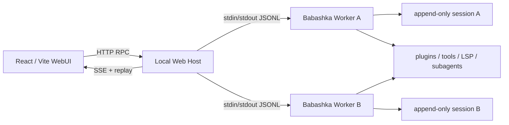

# 本地 WebUI

WebUI 采用与 DeepSeek Harness 相同的分层原则：浏览器只负责投影和交互，本地 Web Host
负责工作区与进程策略，每个打开的会话由一个独立 Babashka Worker 执行。TUI、JSON 和
WebUI 仍共享同一组插件、session log 与 agent runtime。



## 启动

需要 Babashka 1.13+、Node.js 22.12+。首次运行安装前端依赖：

```bash
npm install
bb web
```

默认从 `127.0.0.1:3080` 开始监听；端口已占用时会逐一尝试后续端口，直至成功或到达端口
范围上限。启动日志会打印一个只使用一次的带 token URL；首次打开后，
Host 把随机 token 换成 `HttpOnly + SameSite=Strict` Cookie，并重定向到不含 token 的地址。
可以显式选择首个工作区或端口：

```bash
npm run web:build
npm run web:start -- --workspace /absolute/project/path --port 3080
```

主 Agent 的单次提交默认最多执行 **256 轮**，由 `qi.plugins.runtime` 的
`:max-steps` 控制。每轮包含模型生成和可能的一批工具调用，最终答复也占一轮；
超过上限仍会返回 `Agent exceeded its step limit`，不会无限执行。仓库默认 Profile、
Standard 和 Creator 预设都使用该上限。覆盖顺序为单次运行的 `options :max-steps`、
实际加载的 EDN Profile、runtime 内置默认值 256；显式配置较小的值仍然有效。

Profile 在 Worker 启动时读取，修改后需要重启对应 Worker，刷新浏览器不会重新读取。
选择预设的会话使用 daemon 在创建时保存的配置快照，修改原预设不会自动更新旧快照；
已有会话应核对实际 `config_path`，或基于更新后的预设创建会话。外置用户 Profile 也会
继续保留自己的显式上限。

WebUI 支持：

- 工作区白名单的添加、移除和切换；
- 新项目在开始任务前询问信任；可选择信任、保持受限或取消，取消时保留输入草稿；
- 会话目录、创建、恢复、首轮自动命名、手动重命名、清理与压缩；
- 持久消息、通用工具卡、实时输出、steer、follow-up 和 abort；
- provider 切换、远程审批、subagent 任务与运行时插件/工具清单；
- 与 DeepSeek Harness 对齐的“设置 → 模型”：添加预设或自定义提供方、编辑 API 地址与协议、
  管理模型目录、从兼容端点获取模型，并在保存后即时刷新已打开会话的模型选择器；
- 桌面三栏布局、移动抽屉、键盘焦点、`prefers-reduced-motion`；
- SSE 自动重连与 Host 内事件补发，重启后由 session snapshot 重新投影。

## Worker 协议

`qi.plugins.remote-registry` 提供可逆、JSON Schema 校验的 `:remote/registry`。其他插件
注册声明式方法，`qi.protocol` 只负责 JSONL 传输与旧 RPC 方法兼容，不再集中维护所有
业务分支。默认远程方法包括：

```text
remote.methods
session.snapshot / session.events / session.rename / session.clear
session.compact / session.tree / session.fork（仅 Host 可指定目标）
turn.submit / turn.steer / turn.follow-up / turn.abort / turn.state
interaction.list / interaction.resolve
trust.status
model.list / model.select
command.list / command.execute
runtime.status / subagent.status
```

`session.snapshot` 返回完整的 durable event 投影起点。每条新 session event 带单调递增的
`seq`；`session.events {after}` 可按游标补取。Worker 推送统一 event envelope：

```json
{
  "version": 1,
  "type": "event",
  "session_id": "...",
  "seq": 42,
  "event_id": "...",
  "run_id": "...",
  "event": "tool/result",
  "durable": true,
  "at": "2026-08-18T12:00:00Z",
  "data": {}
}
```

`turn.submit` 立即返回 `request_id`，最终结果以 `remote/run-result` live event 返回，因此
Host 的 HTTP 请求不需要占用到模型运行结束。

## 审批与安全边界

RPC mode 会在 approval 插件前自动插入 `qi.plugins.remote-interaction`。当策略要求审批时，
Worker 发出 `interaction/request`，阻塞的只是工具 future；浏览器通过
`interaction.resolve` 返回 allow、allow-session 或 deny。超时、Worker 退出或最后一个
SSE 客户端断开都会默认 deny。最终 policy decision 仍作为 `approval/decision` 写入 session。

添加项目时，Web 会读取 Worker 的 `trust.status`，展示实际项目路径和信任影响。
已有信任及父目录信任会沿用；选择保持受限后显示状态提示，不反复弹窗。
信任通过 `/trust allow|deny` 保存并读取校验，保存失败不会提交任务。信任状态与访问权限
分别生效，信任项目不会自动绕过工具审批。取消弹窗不会发送消息或执行输入中的命令。

操作审批嵌在输入区，打开工作台时显示在工作台底部；上文和计划内容仍可阅读。
审批期间可编辑草稿，但 Enter 和引导不会提交新任务；失败信息留在审批卡片内，允许重试。
审批卡片内也可停止运行；停止会同时取消等待中的交互，包括没有模型任务的命令审批。
界面等待停止请求返回及真实运行状态结束，失败时保留状态并提供重试；响应丢失时可核对
原操作结果。输入框将附件、文件、计划等入口
集中到“+”菜单，保留访问权限、模型、上下文和发送/停止控件，支持中文输入法与键盘导航。
新会话将工作区、Agent 模式、输入框和快捷开始放在同一个任务区；会话标题、对话/轨迹
切换及详情入口共用一行，正文与输入框保持同宽。手机导航独立于桌面的侧栏收起状态。
同一步的工具调用默认收成类别与数量摘要，展开后可逐项查看参数、结果、截图和插件输出。
失败提示在收起时仍可见，停止后缺少结果的调用显示“结果未确认”。
模型超过四个时提供搜索；菜单支持方向键、Home/End、Escape 和焦点返回，并按视口自动定位。
本轮对照依据与取舍见 [Harness UI 对照](webui-harness-comparison.md)。

Host 的边界：

- 默认仅绑定回环地址；所有 API 与静态资源（健康检查除外）都要求随机 bearer token；
- 非 GET 请求校验 `Origin`，响应启用 CSP、`nosniff`、同源 opener 与禁止 frame；
- 浏览器只能打开 allowlist 中经过 `realpath` 解析的工作区，会话路径完全由 Host 生成；
- 远程命令拒绝带任意目标路径的 `/fork`，运行时状态不会返回 context 正文或认证信息；
- session JSONL、工作区清单和凭据都不会打包进前端产物。
- Web Host 与 worker 读取 `providers.json` 时拒绝符号链接、非当前用户所有或组/其他用户可访问的文件，
  不会通过改权限掩盖已有的不安全设置。模型 API 密钥只写入本机 Web Host 状态目录，文件权限为 `0600`；
  列表和保存响应只返回“是否已配置”，不会把密钥回传给浏览器。
- OpenAI API 与 ChatGPT 订阅是两个独立提供方。前者使用 `OPENAI_API_KEY` 或 Web
  保存的 API Key；环境变量引用仅允许 `OPENAI_API_KEY`、`DEEPSEEK_API_KEY`、`ANTHROPIC_API_KEY`，
  分别绑定固定的官方地址和协议，编辑地址或发现模型时同样校验。自定义端点使用显式保存/输入的 key；
  Responses 注册与请求入口默认都只接受官方地址，Web 用 `:allow-custom-endpoint true` 与
  `:credential-source :settings` 显式启用自定义 key，禁止回退读取宿主环境。后者自动检查 `$CODEX_HOME/auth.json`（默认 `~/.codex/auth.json`）的
  本地 Codex 登录状态。Web 只返回状态和文件路径，不返回 access token、account id 或
  refresh token；过期、格式无效及权限过宽会分别显示为不可用状态。
- `/health/live` 只检查进程存活；`/health/ready` 还会检查静态产物、运行配置、daemon
  二进制和工作区可访问性。

Web Host 是本机单用户边界，不是公网多租户服务。非回环地址默认会被拒绝；只有在已配置
认证和 TLS 的反向代理后，才可显式传入 `--unsafe-allow-network --host ADDRESS`。该开关不把
Web Host 变成多租户服务。

## 测试

文件与变更面板提供会话级结果详略（简洁 / 自动 / 详细）。设置作为
`session/preferences` 事件保存，刷新、worker 恢复和清空对话后仍属于同一会话；
从下一次模型请求起生效，不中断已经发出的请求。保存失败保留已确认设置并允许重试。
`session.preferences` 读取当前偏好，`session.preferences.set {response_detail}` 设置它。

本轮变更默认先展示变更、验收、下一步三行摘要。详细模式展开所有差异，自动模式在
部分捕获时展开第一项与范围说明；简洁模式也始终保留部分记录提示。普通 Web 文件
快照尚无独立验收回执接入，因此摘要明确显示未关联本轮文件指纹的独立验收记录，
不会以运行完成、工具成功或某个历史 CI 结果代替本轮验收。

```bash
npm test
npm run web:build
npm run test:web-browser:ci
npm run test:web-e2e
```

`bb test` 覆盖游标、远程 registry 与异步 interaction；Node 端到端测试会在临时工作区启动
真实 Babashka Worker，验证鉴权、Origin、会话创建和 RPC。前端另经过 TypeScript 检查、
Vite production build，以及桌面和 375px 视口的实际浏览器检查。

`test:web-e2e` 使用生产前端、真实 Web Host、隔离的 Rust daemon 和 Babashka Worker，
模型由确定性的离线 fixture 提供，不调用付费模型，也不复用本机已有 daemon 或用户配置。
覆盖项目信任提示、保存失败、取消后草稿、信任继承、受限模式、中断审批、停止失败重试、
重复点击、停止途中原任务自行结束、响应丢失核对、刷新恢复、输入法、菜单焦点和
320–1440px 布局，并核对真实文件写入结果。
浏览器回归另覆盖审批期间阅读上下文、草稿保留、审批失败重试、工具摘要与逐项展开、
未确认结果、模型搜索空态、键盘选择与焦点恢复。
首次运行需 `npx playwright install chromium`；可通过 `QI_AGENT_E2E_ARTIFACTS` 指定截图目录。
